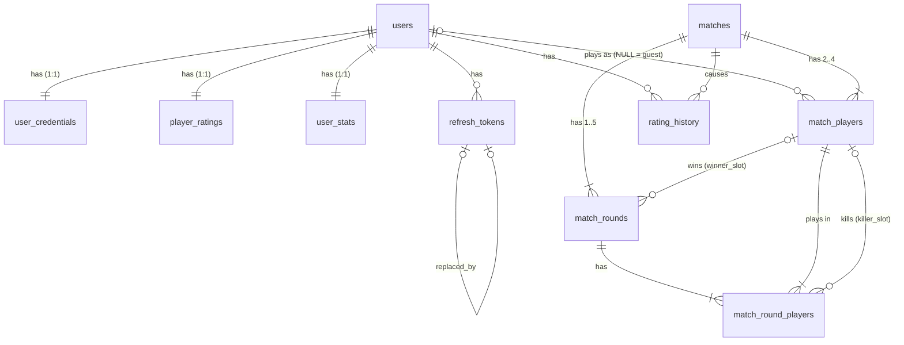

# BomberMan Online: Database Design (PostgreSQL 17)

| | |
|---|---|
| **Version** | 0.4 (draft) |
| **Date** | 2026-11-14 |
| **Parent** | [SPECIFICATION.md §7](./SPECIFICATION.md#7-data-model-postgresql) · [BACKEND-ARCHITECTURE.md §3–§4](./BACKEND-ARCHITECTURE.md#3-database-access-why-no-orm) · [EVENTS-AND-MESSAGING.md §6–§7](./EVENTS-AND-MESSAGING.md#6-producers) |

This document is the **source of truth for the database schema**. It lists every table with its columns, required properties, keys, foreign keys, checks and indexes, explains why each one exists, and shows how the schema maps to Go types (pgx + sqlc, no ORM). Migrations in `server/internal/store/migrations/` must match it. When the schema changes, update this document in the same PR.

### Changelog

| Version | Changes |
|---|---|
| 0.4 | **Solo mode** (SPEC v0.10 §4.9), migration `00007_solo_mode.sql`. `matches.mode` gains `solo` (single round, always private, always with aliens), and `matches.result` and `match_rounds.result` gain `loss`, which only a solo run can have. `match_rounds.end_reason` gains `survived` and `eliminated`. `user_stats` gains `solo_runs`, `solo_wins` and `solo_best_score`; the existing counters stay PvP-only. No new tables, so the grants are unchanged. |
| 0.3 | Follows SPEC v0.9: ranked is 1-vs-1 best-of-3, unrated is a single round. `matches.best_of` is now 1 or 3 and tied to `mode` (`matches_format_check`), and the standard ruleset no longer fixes `best_of`. `match_players` bounds tightened: `round_wins` 0–2, `round_points` 0–9. New column `matches.arena_size` (15 / 17 / 21); the standard ruleset is 15×15 with max 2 aliens. |
| 0.2 | v1 runs PostgreSQL as a container on one VM (SPEC §8), so database roles are password login roles created by an init script instead of Cloud SQL IAM users (§7). Migrations move from golang-migrate to **Goose** (file names and `NO TRANSACTION`, §8). Housekeeping runs inside the worker (§6.1). The tables themselves are unchanged. |
| 0.1 | First version. Builds on SPECIFICATION §7 v0.6 with these changes: per-round player results move from `match_rounds.players JSONB` into a real table, `match_round_players`. Password hashes move to `user_credentials`. Refresh tokens get rotation families and a binary hash. Matches store their full ruleset and the simulation version. The inbox is keyed per consumer. Every constraint has an explicit name. |

---

## 1. Design principles

### 1.1 Composition, never inheritance

Go has no inheritance, and the schema doesn't use any either. In practice:

| Not allowed | What we do instead |
|---|---|
| PostgreSQL table inheritance (`CREATE TABLE … INHERITS (…)`) | Separate tables joined by foreign keys. |
| Single-table inheritance, i.e. one table for several "subtypes" with a `kind` column and columns that are NULL for some kinds (e.g. one `players` table for guests and registered users) | Guests are **not rows**. A guest in a match is `match_players.user_id IS NULL` plus a `display_name` snapshot. |
| Class-table inheritance (`entities` → `users`, `entities` → `bots`, joined by a shared PK) | Each entity owns its own primary key. |
| Polymorphic foreign keys (`owner_type` + `owner_id` with no real FK) | Each relation has its own real FK column. A death by alien uses `alien_type`, not a polymorphic "killer". |
| A Go `BaseEntity{ID, CreatedAt, UpdatedAt}` embedded in every struct | Each struct declares the fields it actually has. |

**Composition** shows up in three forms:

1. **1:1 component tables** that share the parent's primary key: `users` has `user_credentials`, `player_ratings` and `user_stats`. Each component changes for its own reason and has its own writer. Profile reads never touch the password hash, and only the rating worker writes ratings.
2. **Aggregates made of child tables:** a `matches` row owns its `match_players`, `match_rounds` and `match_round_players` (`ON DELETE CASCADE`).
3. **Value objects stored as a column group:** the same set of columns appears in several tables and maps to **one Go struct** that is used as a named field:
   - `Counters` (kills, alien kills, walls destroyed, power-ups taken, bombs placed) in `match_players` and `match_round_players`.
   - `Ruleset` (best-of, wall density, drop rate, aliens) in `matches`.
   - `RatingChange` (before/after) in `match_players` and `rating_history`.

### 1.2 Conventions

| Topic | Rule |
|---|---|
| Names | `snake_case`. Tables are plural nouns. Columns are singular. Booleans read as facts (`rated`, `forfeited`, `aliens_enabled`). |
| Constraint names | Always explicit, in PostgreSQL's default style so they are predictable: `<table>_pkey`, `<table>_<cols>_key` (unique), `<table>_<cols>_fkey`, `<table>_<what>_check`, `<table>_<cols>_idx`. `internal/store` maps unique violations to domain errors **by constraint name** (BACKEND-ARCHITECTURE §4.6), so renaming a constraint is a breaking change. |
| Primary keys | **UUIDv7** generated in Go (`uuid.NewV7()`), with no DB default. UUIDv7 sorts by creation time, so indexes stay compact and `ORDER BY id` is chronological. Child tables use natural composite keys (`(match_id, slot)`). |
| Required vs. optional | `NOT NULL` is the default. A column is nullable only when NULL has a documented meaning (e.g. `user_id IS NULL` means guest). Each nullable column is listed in the column tables below. |
| Strings | `TEXT` with a `CHECK` on length/format, never `VARCHAR(n)`. Case-insensitive identifiers use `CITEXT`. |
| Enumerations | `TEXT` + a named `CHECK (col IN (…))`, mapped to a named Go string type. This is easier than PostgreSQL `ENUM` types under expand → contract, because adding or removing a value is a constraint swap (`ADD … NOT VALID` → `VALIDATE`) and doesn't need a type rewrite. |
| Numbers | Integers only (matching the integer-only simulation). `SMALLINT` for small bounded values (slots, placements, per-match counters), `INT` for ratings and lifetime counters, `BIGINT` for seeds. No `REAL`, `DOUBLE PRECISION` or `NUMERIC`. |
| Time | `TIMESTAMPTZ` only, stored in UTC. Durations are `INT` milliseconds (`*_ms`). Game time is `INT` ticks (`*_tick`). |
| Foreign keys | Every FK has an explicit `ON DELETE` policy. Every FK column (or column group) is the leading part of an index, unless §5 lists it as an exception. PostgreSQL doesn't create these indexes automatically. |
| CHECKs on nullable columns | A CHECK that evaluates to NULL **passes**, so a condition on a nullable column can quietly let bad rows through. Write the null case out explicitly: `(a IS NULL) = (b IS NULL)` for "both or neither", and `col IS NOT DISTINCT FROM 'x'` instead of `col = 'x'`. Every such CHECK gets a test with the NULL case (§8). |
| JSON | Used only for opaque payloads (`outbox.payload`). Anything that is queried, joined or constrained gets real columns. |
| Defaults | DB defaults only for `now()` timestamps and zero counters. Business values (rating 1200, etc.) also come from Go, so they live in one place. The DB defaults match them as a safety net. |

### 1.3 Ownership: who writes what

The **game server never writes to PostgreSQL** (it only `LISTEN`s). Each table has exactly one writing service:

| Table | Writer | Readers |
|---|---|---|
| `users`, `user_credentials`, `refresh_tokens`, `outbox` | API | API |
| `player_ratings` | API (insert at registration), **worker** (all updates) | API |
| `user_stats` | API (insert at registration), **worker** (all updates) | API |
| `matches`, `match_players`, `match_rounds`, `match_round_players`, `rating_history`, `processed_events` | **Worker** | API |

This ownership is enforced with database roles (§7), not just by convention.

---

## 2. Entity-relationship overview



Two tables stand alone, with no FKs: `processed_events` (inbox) and `outbox`. That is on purpose. Their rows are deleted on a retention schedule that has nothing to do with the business rows (§6).

---

## 3. Tables

Each table is shown as a column list followed by the DDL. The DDL is written to go straight into a migration file.

### 3.0 Extensions

```sql
CREATE EXTENSION IF NOT EXISTS citext;
```

### 3.1 `users`: the account identity

The core of an account: identity and contact details only. Everything else about a user is a component table.

| Column | Type | Null | Notes |
|---|---|---|---|
| `id` | `UUID` | no | PK, UUIDv7 |
| `username` | `CITEXT` | no | Unique, case-insensitive. 3–16 chars, `[A-Za-z0-9_]` (SPEC §3.2) |
| `email` | `CITEXT` | no | Unique, case-insensitive, ≤ 254 chars. Never logged or put in events (SPEC §9). |
| `created_at` | `TIMESTAMPTZ` | no | |
| `updated_at` | `TIMESTAMPTZ` | no | Set by the API on every update |
| `last_login_at` | `TIMESTAMPTZ` | **yes** | NULL = never logged in after registering |

```sql
CREATE TABLE users (
  id             UUID        NOT NULL,
  username       CITEXT      NOT NULL,
  email          CITEXT      NOT NULL,
  created_at     TIMESTAMPTZ NOT NULL DEFAULT now(),
  updated_at     TIMESTAMPTZ NOT NULL DEFAULT now(),
  last_login_at  TIMESTAMPTZ NULL,
  CONSTRAINT users_pkey           PRIMARY KEY (id),
  CONSTRAINT users_username_key   UNIQUE (username),
  CONSTRAINT users_email_key      UNIQUE (email),
  CONSTRAINT users_username_check CHECK (username ~ '^[A-Za-z0-9_]{3,16}$'),
  CONSTRAINT users_email_check    CHECK (length(email) <= 254 AND email ~ '^[^@\s]+@[^@\s]+$')
);
```

- The unique constraints also provide the login lookup indexes (`username = $1`, `email = $1`).
- The regex checks are a safety net. `account.NewUsername` validates first and returns a domain error (BACKEND-ARCHITECTURE §4.4).
- Guest nicknames are never stored. The rule that a guest can't impersonate a registered username is checked by the API against `users_username_key` when the guest token is issued.

### 3.2 `user_credentials`: password (1:1 component)

Kept apart from `users` so profile and leaderboard queries can't select the hash by accident. A future OAuth login becomes a sibling component table (`user_oauth_identities`), and `users` doesn't change.

| Column | Type | Null | Notes |
|---|---|---|---|
| `user_id` | `UUID` | no | PK and FK → `users.id`, cascade |
| `password_hash` | `TEXT` | no | PHC string (`$argon2id$v=19$…`), which includes the parameters and salt |
| `password_changed_at` | `TIMESTAMPTZ` | no | |

```sql
CREATE TABLE user_credentials (
  user_id              UUID        NOT NULL,
  password_hash        TEXT        NOT NULL,
  password_changed_at  TIMESTAMPTZ NOT NULL DEFAULT now(),
  CONSTRAINT user_credentials_pkey         PRIMARY KEY (user_id),
  CONSTRAINT user_credentials_user_id_fkey FOREIGN KEY (user_id) REFERENCES users (id) ON DELETE CASCADE,
  CONSTRAINT user_credentials_hash_check   CHECK (password_hash LIKE '$argon2id$%' OR password_hash LIKE '$2_$%')
);
```

### 3.3 `refresh_tokens`

Opaque refresh tokens (SPEC §3.3), stored only as a SHA-256 hash. Tokens are **rotated** on each `/api/auth/refresh`. Each login starts a `family_id`. If a token that was already replaced is presented again, that is treated as theft and the whole family is revoked.

| Column | Type | Null | Notes |
|---|---|---|---|
| `id` | `UUID` | no | PK, UUIDv7 |
| `user_id` | `UUID` | no | FK → `users.id`, cascade |
| `family_id` | `UUID` | no | Same for every token in one login session. Equal to the first token's `id`. |
| `token_hash` | `BYTEA` | no | `sha256(token)`, exactly 32 bytes, unique |
| `created_at` | `TIMESTAMPTZ` | no | |
| `expires_at` | `TIMESTAMPTZ` | no | `created_at + 30 days` |
| `revoked_at` | `TIMESTAMPTZ` | **yes** | NULL = still valid (unless expired). Set on logout, rotation or reuse detection. |
| `replaced_by` | `UUID` | **yes** | FK → `refresh_tokens.id`. The token issued when this one was rotated. NULL = not rotated. |

```sql
CREATE TABLE refresh_tokens (
  id           UUID        NOT NULL,
  user_id      UUID        NOT NULL,
  family_id    UUID        NOT NULL,
  token_hash   BYTEA       NOT NULL,
  created_at   TIMESTAMPTZ NOT NULL DEFAULT now(),
  expires_at   TIMESTAMPTZ NOT NULL,
  revoked_at   TIMESTAMPTZ NULL,
  replaced_by  UUID        NULL,
  CONSTRAINT refresh_tokens_pkey             PRIMARY KEY (id),
  CONSTRAINT refresh_tokens_token_hash_key   UNIQUE (token_hash),
  CONSTRAINT refresh_tokens_user_id_fkey     FOREIGN KEY (user_id)     REFERENCES users (id)          ON DELETE CASCADE,
  CONSTRAINT refresh_tokens_replaced_by_fkey FOREIGN KEY (replaced_by) REFERENCES refresh_tokens (id) ON DELETE SET NULL,
  CONSTRAINT refresh_tokens_token_hash_check CHECK (octet_length(token_hash) = 32),
  CONSTRAINT refresh_tokens_expiry_check     CHECK (expires_at > created_at),
  CONSTRAINT refresh_tokens_replaced_check   CHECK (replaced_by IS NULL OR revoked_at IS NOT NULL)
);
-- "log out everywhere" / per-user revocation; FK index
CREATE INDEX refresh_tokens_user_id_idx    ON refresh_tokens (user_id) WHERE revoked_at IS NULL;
-- revoke a whole family on reuse detection
CREATE INDEX refresh_tokens_family_id_idx  ON refresh_tokens (family_id);
-- FK index for the self-reference (rarely used, keeps ON DELETE SET NULL cheap)
CREATE INDEX refresh_tokens_replaced_by_idx ON refresh_tokens (replaced_by) WHERE replaced_by IS NOT NULL;
-- housekeeping
CREATE INDEX refresh_tokens_expires_at_idx ON refresh_tokens (expires_at);
```

- **Lookup:** `WHERE token_hash = $1` through `refresh_tokens_token_hash_key`. A plain SHA-256 is enough here because the token is 256 random bits, not a password.
- The partial `user_id` index covers revocation, but cascade deletes need the full column. Cascade deletes on `user_id` only happen with account deletion, and expired or revoked rows are pruned (§6), so a seq-scan risk is limited to a few rows per user. If account deletion ever gets slow, make the index non-partial.

### 3.4 `player_ratings`: ELO (1:1 component)

| Column | Type | Null | Notes |
|---|---|---|---|
| `user_id` | `UUID` | no | PK and FK → `users.id`, cascade |
| `rating` | `INT` | no | Current rating, ≥ 100 (floor, SPEC §5.4.1) |
| `peak_rating` | `INT` | no | ≥ `rating`, ≥ 1200 |
| `rated_matches` | `INT` | no | ≥ 0. Picks the K-factor (< 15 → 40) and leaderboard eligibility (≥ 10). |
| `updated_at` | `TIMESTAMPTZ` | no | |

```sql
CREATE TABLE player_ratings (
  user_id        UUID        NOT NULL,
  rating         INT         NOT NULL DEFAULT 1200,
  peak_rating    INT         NOT NULL DEFAULT 1200,
  rated_matches  INT         NOT NULL DEFAULT 0,
  updated_at     TIMESTAMPTZ NOT NULL DEFAULT now(),
  CONSTRAINT player_ratings_pkey               PRIMARY KEY (user_id),
  CONSTRAINT player_ratings_user_id_fkey       FOREIGN KEY (user_id) REFERENCES users (id) ON DELETE CASCADE,
  CONSTRAINT player_ratings_rating_check       CHECK (rating >= 100),
  CONSTRAINT player_ratings_peak_check         CHECK (peak_rating >= rating AND peak_rating >= 1200),
  CONSTRAINT player_ratings_rated_matches_check CHECK (rated_matches >= 0)
);
-- Leaderboard page + rank: only players past placement (SPEC §5.4.1, §7)
CREATE INDEX player_ratings_leaderboard_idx
  ON player_ratings (rating DESC, user_id) WHERE rated_matches >= 10;
```

- **Leaderboard page:** `WHERE rated_matches >= 10 ORDER BY rating DESC, user_id LIMIT $1 OFFSET $2`, served from the partial index alone. `user_id` makes the order stable for tied ratings.
- **Rank:** `SELECT 1 + count(*) FROM player_ratings WHERE rated_matches >= 10 AND rating > $1`, an index-only range scan on the same index. Tied players share a rank.
- `peak_rating >= 1200` holds because the starting rating is the first peak.

### 3.5 `user_stats`: lifetime totals (1:1 component)

Denormalized counters for fast profile reads. Created at registration together with `player_ratings`. The worker updates them with an upsert so a missing row can never fail a match.

| Column | Type | Null | Notes |
|---|---|---|---|
| `user_id` | `UUID` | no | PK and FK → `users.id`, cascade |
| `matches_played`, `matches_won`, `matches_drawn`, `forfeits` | `INT` | no | Per match. `matches_won` = placement 1 in a `win` match. `matches_drawn` = shared placement 1. |
| `rounds_played`, `rounds_won` | `INT` | no | Per round |
| `kills`, `alien_kills`, `walls_destroyed`, `powerups_taken`, `bombs_placed` | `INT` | no | Lifetime `Counters` (§4.2). Self-kills are not kills (SPEC §7). |
| `deaths`, `deaths_by_alien` | `INT` | no | Per round eliminated. `deaths_by_alien` ⊆ `deaths`. |
| `updated_at` | `TIMESTAMPTZ` | no | |
| `solo_runs`, `solo_wins` | `INT` | no | Solo mode (SPEC §4.9): runs finished, and runs survived to the time limit. `solo_wins` ≤ `solo_runs`. |
| `solo_best_score` | `INT` | no | Highest solo score (aliens killed in one run). Updated with `GREATEST`. |

**All columns above `solo_*` count PvP matches only** (ranked and unrated). A solo run changes only the three `solo_*` columns. This keeps the win rate and the `deaths <= rounds_played` check meaningful, and totals that include solo play can still be computed from the match tables.

```sql
CREATE TABLE user_stats (
  user_id          UUID        NOT NULL,
  matches_played   INT         NOT NULL DEFAULT 0,
  matches_won      INT         NOT NULL DEFAULT 0,
  matches_drawn    INT         NOT NULL DEFAULT 0,
  forfeits         INT         NOT NULL DEFAULT 0,
  rounds_played    INT         NOT NULL DEFAULT 0,
  rounds_won       INT         NOT NULL DEFAULT 0,
  kills            INT         NOT NULL DEFAULT 0,
  alien_kills      INT         NOT NULL DEFAULT 0,
  walls_destroyed  INT         NOT NULL DEFAULT 0,
  powerups_taken   INT         NOT NULL DEFAULT 0,
  bombs_placed     INT         NOT NULL DEFAULT 0,
  deaths           INT         NOT NULL DEFAULT 0,
  deaths_by_alien  INT         NOT NULL DEFAULT 0,
  updated_at       TIMESTAMPTZ NOT NULL DEFAULT now(),
  solo_runs        INT         NOT NULL DEFAULT 0,   -- added by 00007
  solo_wins        INT         NOT NULL DEFAULT 0,
  solo_best_score  INT         NOT NULL DEFAULT 0,
  CONSTRAINT user_stats_pkey         PRIMARY KEY (user_id),
  CONSTRAINT user_stats_user_id_fkey FOREIGN KEY (user_id) REFERENCES users (id) ON DELETE CASCADE,
  CONSTRAINT user_stats_matches_check CHECK (
    matches_played >= 0 AND matches_won >= 0 AND matches_drawn >= 0 AND forfeits >= 0
    AND matches_won + matches_drawn <= matches_played AND forfeits <= matches_played),
  CONSTRAINT user_stats_rounds_check  CHECK (rounds_played >= 0 AND rounds_won BETWEEN 0 AND rounds_played),
  CONSTRAINT user_stats_counters_check CHECK (
    kills >= 0 AND alien_kills >= 0 AND walls_destroyed >= 0 AND powerups_taken >= 0 AND bombs_placed >= 0),
  CONSTRAINT user_stats_deaths_check  CHECK (deaths_by_alien BETWEEN 0 AND deaths AND deaths <= rounds_played),
  CONSTRAINT user_stats_solo_check    CHECK (
    solo_runs >= 0 AND solo_wins BETWEEN 0 AND solo_runs AND solo_best_score >= 0)
);
```

- Renamed from the SPEC v0.6 draft: `wins` → `matches_won` and `round_wins` → `rounds_won`. Added `matches_drawn`, `walls_destroyed`, `powerups_taken` and `bombs_placed`, so that every match-level counter has a lifetime total.
- These numbers can always be rebuilt from `match_players` and `match_round_players`, so they are a cache, not the record.

### 3.6 `matches`: the match aggregate root

One row per finished match that had **at least one registered player** (guest-only matches go to BigQuery only, EVENTS §7.2). A match is a ranked best-of-3, an unrated single round, or a **solo run** (one player against the aliens, SPEC §4.9); a guest's solo run is therefore never stored. Aborted matches are never stored. `id` is the game server's `matchId`, which is also the CloudEvents `ce-id`.

| Column | Type | Null | Notes |
|---|---|---|---|
| `id` | `UUID` | no | PK, UUIDv7 generated **at match start** by the game server |
| `arena_id` | `TEXT` | no | In-memory arena ID (e.g. `a-7KQ2`). Not an FK, because arenas aren't stored. |
| `arena_name` | `TEXT` | no | Snapshot, 1–32 chars |
| `region` | `TEXT` | no | GCP region, `europe-*` only (SPEC §8.1) |
| `sim_version` | `TEXT` | no | Version of `internal/game` that ran the match. Needed to replay a round from `seed` + input log. |
| `mode` | `TEXT` | no | `ranked` \| `unrated` \| `solo` |
| `private` | `BOOLEAN` | no | Private arenas are `unrated` or `solo`. A solo arena is always private: it is never listed or joinable. |
| **Ruleset** (value object, §4.2) | | | |
| `ruleset` | `TEXT` | no | `standard` \| `custom` |
| `best_of` | `SMALLINT` | no | **3** for ranked, **1** for unrated and solo (SPEC §4.8.3, §4.9) |
| `arena_size` | `SMALLINT` | no | 15, 17 or 21 (tiles per side, SPEC §4.1). Always 15 for ranked. |
| `wall_density_pct` | `SMALLINT` | no | 40–85 |
| `wall_drop_pct` | `SMALLINT` | no | 0–60 |
| `aliens_enabled` | `BOOLEAN` | no | |
| `max_aliens` | `SMALLINT` | no | 0–8. Solo: at least 1; the difficulty sets it (2 / 4 / 6). |
| **Outcome** | | | |
| `rounds_played` | `SMALLINT` | no | 1..`best_of` |
| `result` | `TEXT` | no | PvP: `win` \| `draw` (shared 1st place). Solo: `win` (survived) \| `loss` (eliminated). |
| `rated` | `BOOLEAN` | no | Rating actually applied (SPEC §5.4.2). Inserted `false`, set `true` in the same transaction after ELO. |
| **Timing** | | | |
| `started_at`, `ended_at` | `TIMESTAMPTZ` | no | Game server clock |
| `duration_ms` | `INT` | no | ≥ 0 |
| `recorded_at` | `TIMESTAMPTZ` | no | When the worker persisted it (DB clock). Shows pipeline lag. |

```sql
CREATE TABLE matches (
  id                UUID        NOT NULL,
  arena_id          TEXT        NOT NULL,
  arena_name        TEXT        NOT NULL,
  region            TEXT        NOT NULL,
  sim_version       TEXT        NOT NULL,
  mode              TEXT        NOT NULL,
  private           BOOLEAN     NOT NULL,
  ruleset           TEXT        NOT NULL,
  best_of           SMALLINT    NOT NULL,
  arena_size        SMALLINT    NOT NULL,
  wall_density_pct  SMALLINT    NOT NULL,
  wall_drop_pct     SMALLINT    NOT NULL,
  aliens_enabled    BOOLEAN     NOT NULL,
  max_aliens        SMALLINT    NOT NULL,
  rounds_played     SMALLINT    NOT NULL,
  result            TEXT        NOT NULL,
  rated             BOOLEAN     NOT NULL DEFAULT false,
  started_at        TIMESTAMPTZ NOT NULL,
  ended_at          TIMESTAMPTZ NOT NULL,
  duration_ms       INT         NOT NULL,
  recorded_at       TIMESTAMPTZ NOT NULL DEFAULT now(),
  CONSTRAINT matches_pkey              PRIMARY KEY (id),
  CONSTRAINT matches_arena_check       CHECK (length(arena_id) BETWEEN 1 AND 16 AND length(arena_name) BETWEEN 1 AND 32),
  CONSTRAINT matches_region_check      CHECK (region ~ '^europe-[a-z]+[0-9]+$'),
  CONSTRAINT matches_sim_version_check CHECK (length(sim_version) BETWEEN 1 AND 64),
  CONSTRAINT matches_mode_check        CHECK (mode IN ('ranked', 'unrated', 'solo')),
  CONSTRAINT matches_ruleset_check     CHECK (ruleset IN ('standard', 'custom')),
  CONSTRAINT matches_result_check      CHECK (result IN ('win', 'draw', 'loss')),
  -- Ranked is best-of-3; unrated and solo are a single round (SPEC §4.8.3, §4.9)
  CONSTRAINT matches_format_check      CHECK (
    (mode = 'ranked' AND best_of = 3) OR (mode IN ('unrated', 'solo') AND best_of = 1)),
  -- A solo arena is never listed or joinable, and it always has aliens
  CONSTRAINT matches_solo_check        CHECK (mode <> 'solo' OR (private AND aliens_enabled AND max_aliens >= 1)),
  -- Solo ends in win or loss, never a draw; PvP ends in win or draw, never a loss
  CONSTRAINT matches_solo_result_check CHECK (
    CASE WHEN mode = 'solo' THEN result IN ('win', 'loss') ELSE result IN ('win', 'draw') END),
  CONSTRAINT matches_rounds_check      CHECK (rounds_played BETWEEN 1 AND best_of),
  CONSTRAINT matches_rule_values_check CHECK (
    arena_size IN (15, 17, 21)
    AND wall_density_pct BETWEEN 40 AND 85 AND wall_drop_pct BETWEEN 0 AND 60 AND max_aliens BETWEEN 0 AND 8),
  -- 'standard' means exactly the locked map rules (SPEC §5.4.2 item 2); the format follows the mode
  CONSTRAINT matches_standard_ruleset_check CHECK (
    ruleset <> 'standard' OR (arena_size = 15 AND wall_density_pct = 65 AND wall_drop_pct = 30
                              AND aliens_enabled AND max_aliens = 2)),
  -- Ranked arenas are public and use the standard ruleset (SPEC §5.1, §5.4.2)
  CONSTRAINT matches_ranked_check      CHECK (mode <> 'ranked' OR (ruleset = 'standard' AND NOT private)),
  -- Only ranked matches can be rated
  CONSTRAINT matches_rated_check       CHECK (NOT rated OR mode = 'ranked'),
  CONSTRAINT matches_timing_check      CHECK (ended_at >= started_at AND duration_ms >= 0)
);
-- "recent matches" / admin views, housekeeping by age
CREATE INDEX matches_ended_at_idx ON matches (ended_at DESC);
```

- The rules that depend on players (a ranked match has exactly 2 players, both registered; a solo run has exactly 1 player in slot 1) are checked in Go. A CHECK can't look at other rows.
- The DDL above is the current state. `00004_matches.sql` created the table, and `00007_solo_mode.sql` widened `mode_check`, `result_check` and `format_check` and added the two `solo` checks. A solo run can be `ruleset = 'standard'` (Easy on a Small arena has exactly the standard values) or `custom`.
- `arena_id` and `arena_name` are snapshots. Arenas exist only in memory (SPEC §7), so there is nothing to reference.

### 3.7 `match_players`: one row per roster slot

| Column | Type | Null | Notes |
|---|---|---|---|
| `match_id` | `UUID` | no | PK part, FK → `matches.id`, cascade |
| `slot` | `SMALLINT` | no | PK part, 1–4 (spawn corner P1–P4) |
| `user_id` | `UUID` | **yes** | FK → `users.id`, **set null**. NULL = guest, or a user who was later deleted. |
| `display_name` | `TEXT` | no | Name shown in that match (snapshot). Replaced with `Deleted player` when the account is deleted (§6.2). |
| **Standing** | | | |
| `placement` | `SMALLINT` | no | **Match** placement 1–4 (SPEC §4.8.3; 1–2 in ranked; always 1 in solo). Ties share a value. |
| `round_wins` | `SMALLINT` | no | 0–2 (first to 2 wins the ranked best-of-3) |
| `round_points` | `SMALLINT` | no | 0–9 (3 points × at most 3 rounds) |
| `forfeited` | `BOOLEAN` | no | |
| **Counters** (value object, totals over all rounds) | | | |
| `kills`, `alien_kills`, `walls_destroyed`, `powerups_taken`, `bombs_placed` | `SMALLINT` | no | ≥ 0 |
| **RatingChange** (value object) | | | |
| `rating_before`, `rating_after` | `INT` | **yes** | Both NULL (unrated, or a guest) or both set |

```sql
CREATE TABLE match_players (
  match_id         UUID     NOT NULL,
  slot             SMALLINT NOT NULL,
  user_id          UUID     NULL,
  display_name     TEXT     NOT NULL,
  placement        SMALLINT NOT NULL,
  round_wins       SMALLINT NOT NULL DEFAULT 0,
  round_points     SMALLINT NOT NULL DEFAULT 0,
  forfeited        BOOLEAN  NOT NULL DEFAULT false,
  kills            SMALLINT NOT NULL DEFAULT 0,
  alien_kills      SMALLINT NOT NULL DEFAULT 0,
  walls_destroyed  SMALLINT NOT NULL DEFAULT 0,
  powerups_taken   SMALLINT NOT NULL DEFAULT 0,
  bombs_placed     SMALLINT NOT NULL DEFAULT 0,
  rating_before    INT      NULL,
  rating_after     INT      NULL,
  CONSTRAINT match_players_pkey              PRIMARY KEY (match_id, slot),
  CONSTRAINT match_players_match_user_key    UNIQUE (match_id, user_id),  -- a user holds at most one slot; NULLs (guests) are distinct
  CONSTRAINT match_players_match_id_fkey     FOREIGN KEY (match_id) REFERENCES matches (id) ON DELETE CASCADE,
  CONSTRAINT match_players_user_id_fkey      FOREIGN KEY (user_id)  REFERENCES users (id)   ON DELETE SET NULL,
  CONSTRAINT match_players_slot_check        CHECK (slot BETWEEN 1 AND 4),
  CONSTRAINT match_players_display_name_check CHECK (length(display_name) BETWEEN 1 AND 32),
  CONSTRAINT match_players_standing_check    CHECK (
    placement BETWEEN 1 AND 4 AND round_wins BETWEEN 0 AND 2 AND round_points BETWEEN 0 AND 9),
  CONSTRAINT match_players_counters_check    CHECK (
    kills >= 0 AND alien_kills >= 0 AND walls_destroyed >= 0 AND powerups_taken >= 0 AND bombs_placed >= 0),
  -- both-or-neither written with IS NULL on both sides, so the check can never evaluate to NULL (see §3.9 "NULL trap")
  CONSTRAINT match_players_rating_check      CHECK (
    (rating_before IS NULL) = (rating_after IS NULL)
    AND (rating_before IS NULL OR (rating_before >= 100 AND rating_after >= 100)))
);
-- Match history of a user, newest first: match_id is UUIDv7 (time-ordered), so no join is needed to sort
CREATE INDEX match_players_user_id_idx ON match_players (user_id, match_id DESC) WHERE user_id IS NOT NULL;
```

- **Match history query** (`ProfileService.ListMatches`, SPEC §6.1): keyset pagination on `(user_id, match_id DESC)` with `match_id < $cursor`, then join `matches` by PK. UUIDv7 time order is the match start time. That's the right order for history, and it removes the need for an index on `matches(ended_at)` joined to users.
- The partial `WHERE user_id IS NOT NULL` index also serves the `ON DELETE SET NULL` from `users`: the lookup is `user_id = $deleted`, which is never NULL.
- `match_players_match_user_key` leads with `match_id`, so it doesn't replace `match_players_user_id_idx`.
- `rating_check` only enforces "both or neither". It deliberately does **not** require `user_id IS NOT NULL`: deleting an account sets `user_id` to NULL on rows that have ratings, and such a CHECK would make that `ON DELETE SET NULL` fail and block the deletion. "Guests are never rated" is enforced in `internal/rating`, which never builds a `RatingChange` for a slot without a user.

### 3.8 `match_rounds`: one row per round played

| Column | Type | Null | Notes |
|---|---|---|---|
| `match_id` | `UUID` | no | PK part, FK → `matches.id`, cascade |
| `round_no` | `SMALLINT` | no | PK part, 1–3 |
| `seed` | `BIGINT` | no | Map/PRNG seed. Go `uint64` stored bit-for-bit as `int64` (§4.3). |
| `started_at` | `TIMESTAMPTZ` | no | |
| `duration_ms` | `INT` | no | 0–200,000 (3:00 + slack) |
| `end_tick` | `INT` | no | Tick on which the round ended, ≥ 0. Lets you check `eliminated_tick` values. |
| `result` | `TEXT` | no | `win` \| `draw` \| `loss` (solo only) |
| `end_reason` | `TEXT` | no | PvP: `last_standing` \| `timeout_hp` \| `simultaneous`. Solo: `survived` (alive at the time limit, a win) \| `eliminated` (a loss). |
| `winner_slot` | `SMALLINT` | **yes** | FK → `match_players (match_id, slot)`. Set ⇔ `result = 'win'`. NULL for a draw and for a solo loss. |
| `input_log_uri` | `TEXT` | **yes** | `gs://…` replay file. NULL = not recorded. |

```sql
CREATE TABLE match_rounds (
  match_id       UUID        NOT NULL,
  round_no       SMALLINT    NOT NULL,
  seed           BIGINT      NOT NULL,
  started_at     TIMESTAMPTZ NOT NULL,
  duration_ms    INT         NOT NULL,
  end_tick       INT         NOT NULL,
  result         TEXT        NOT NULL,
  end_reason     TEXT        NOT NULL,
  winner_slot    SMALLINT    NULL,
  input_log_uri  TEXT        NULL,
  CONSTRAINT match_rounds_pkey             PRIMARY KEY (match_id, round_no),
  CONSTRAINT match_rounds_match_id_fkey    FOREIGN KEY (match_id) REFERENCES matches (id) ON DELETE CASCADE,
  CONSTRAINT match_rounds_winner_fkey      FOREIGN KEY (match_id, winner_slot) REFERENCES match_players (match_id, slot),
  CONSTRAINT match_rounds_round_no_check   CHECK (round_no BETWEEN 1 AND 3),
  CONSTRAINT match_rounds_timing_check     CHECK (duration_ms BETWEEN 0 AND 200000 AND end_tick >= 0),
  CONSTRAINT match_rounds_result_check     CHECK (result IN ('win', 'draw', 'loss')),
  CONSTRAINT match_rounds_end_reason_check CHECK (
    end_reason IN ('last_standing', 'timeout_hp', 'simultaneous', 'survived', 'eliminated')),
  CONSTRAINT match_rounds_winner_check     CHECK ((result = 'win') = (winner_slot IS NOT NULL)),
  CONSTRAINT match_rounds_simultaneous_check CHECK (end_reason <> 'simultaneous' OR result = 'draw'),
  -- solo (00007): eliminated ⇔ loss, and survived ⇒ win
  CONSTRAINT match_rounds_solo_end_check   CHECK (
    (end_reason = 'eliminated') = (result = 'loss') AND (end_reason <> 'survived' OR result = 'win')),
  CONSTRAINT match_rounds_input_log_check  CHECK (input_log_uri IS NULL OR input_log_uri LIKE 'gs://%')
);
```

- `winner_fkey` is a **composite FK**, so the winner must be a slot of the *same* match. With the default `MATCH SIMPLE`, a NULL `winner_slot` (a draw) skips the check. It has no `ON DELETE` action: rows are only deleted through the `matches` cascade, which removes both sides in the same statement, and `NO ACTION` is checked at the end of the statement.
- `round_no <= matches.rounds_played` is a cross-table rule, so it's checked in Go. So is "`survived` and `eliminated` appear only in solo matches".
- In a solo round, `match_round_players` has one row: placement 1, 3 points for a win and 0 for a loss. Dying to your own bomb is `death_cause = 'bomb'` with `killer_slot = slot`.

### 3.9 `match_round_players`: per-round result per player

Replaces the `match_rounds.players JSONB` column from the SPEC v0.6 draft. With real rows, the "how did I die" stats and per-round history are plain SQL, the killer and winner are FK-checked, and the column group is the same `Counters` value object as in `match_players`.

| Column | Type | Null | Notes |
|---|---|---|---|
| `match_id`, `round_no` | `UUID`, `SMALLINT` | no | PK part, FK → `match_rounds`, cascade |
| `slot` | `SMALLINT` | no | PK part, FK → `match_players (match_id, slot)`, cascade |
| `placement` | `SMALLINT` | no | **Round** placement 1–4 (SPEC §4.8.2) |
| `points` | `SMALLINT` | no | 0–3 |
| `hp_left` | `SMALLINT` | no | 0–5. HP at round end. Explains `timeout_hp` placements. |
| `eliminated_tick` | `INT` | **yes** | NULL = survived the round |
| `death_cause` | `TEXT` | **yes** | `bomb` \| `alien` \| `wall` (sudden death) \| `disconnect` (15 s grace ran out) \| `forfeit`. Set ⇔ eliminated. |
| `killer_slot` | `SMALLINT` | **yes** | FK → `match_players (match_id, slot)`. Only for `bomb`. Can equal `slot` (self-kill, which is not credited as a kill). |
| `alien_type` | `TEXT` | **yes** | `drifter` \| `seeker` \| `brute`. Set ⇔ `death_cause = 'alien'`. |
| **Counters** (value object, this round only) | | | |
| `kills`, `alien_kills`, `walls_destroyed`, `powerups_taken`, `bombs_placed` | `SMALLINT` | no | ≥ 0 |

```sql
CREATE TABLE match_round_players (
  match_id         UUID     NOT NULL,
  round_no         SMALLINT NOT NULL,
  slot             SMALLINT NOT NULL,
  placement        SMALLINT NOT NULL,
  points           SMALLINT NOT NULL,
  hp_left          SMALLINT NOT NULL,
  eliminated_tick  INT      NULL,
  death_cause      TEXT     NULL,
  killer_slot      SMALLINT NULL,
  alien_type       TEXT     NULL,
  kills            SMALLINT NOT NULL DEFAULT 0,
  alien_kills      SMALLINT NOT NULL DEFAULT 0,
  walls_destroyed  SMALLINT NOT NULL DEFAULT 0,
  powerups_taken   SMALLINT NOT NULL DEFAULT 0,
  bombs_placed     SMALLINT NOT NULL DEFAULT 0,
  CONSTRAINT match_round_players_pkey        PRIMARY KEY (match_id, round_no, slot),
  CONSTRAINT match_round_players_round_fkey  FOREIGN KEY (match_id, round_no)    REFERENCES match_rounds (match_id, round_no) ON DELETE CASCADE,
  CONSTRAINT match_round_players_player_fkey FOREIGN KEY (match_id, slot)        REFERENCES match_players (match_id, slot)    ON DELETE CASCADE,
  CONSTRAINT match_round_players_killer_fkey FOREIGN KEY (match_id, killer_slot) REFERENCES match_players (match_id, slot),
  CONSTRAINT match_round_players_standing_check CHECK (
    placement BETWEEN 1 AND 4 AND points BETWEEN 0 AND 3 AND hp_left BETWEEN 0 AND 5),
  CONSTRAINT match_round_players_death_cause_check CHECK (
    death_cause IN ('bomb', 'alien', 'wall', 'disconnect', 'forfeit')),
  CONSTRAINT match_round_players_alien_type_check CHECK (alien_type IN ('drifter', 'seeker', 'brute')),
  -- eliminated ⇔ has a cause; survivors have HP left
  CONSTRAINT match_round_players_elimination_check CHECK (
    (eliminated_tick IS NULL) = (death_cause IS NULL)
    AND (eliminated_tick IS NULL OR eliminated_tick >= 0)
    AND (eliminated_tick IS NOT NULL OR hp_left > 0)),
  CONSTRAINT match_round_players_killer_check CHECK (killer_slot IS NULL OR death_cause IS NOT DISTINCT FROM 'bomb'),
  CONSTRAINT match_round_players_alien_check  CHECK ((death_cause IS NOT DISTINCT FROM 'alien') = (alien_type IS NOT NULL)),
  CONSTRAINT match_round_players_counters_check CHECK (
    kills >= 0 AND alien_kills >= 0 AND walls_destroyed >= 0 AND powerups_taken >= 0 AND bombs_placed >= 0)
);
```

- **NULL trap:** a CHECK that evaluates to NULL **passes**. A plain `death_cause = 'alien'` is NULL for a survivor, so a survivor row with an `alien_type` or `killer_slot` would get through. `IS NOT DISTINCT FROM` returns `false` instead of NULL, so `killer_check` and `alien_check` also reject those rows. Use this form in every CHECK that compares a nullable column.
- A `bomb` death may have a NULL `killer_slot` if the bomb owner's slot was not on the roster. That can't happen in v1, but the schema doesn't need to forbid it.
- Up to 4 × 5 = **20 rows per match**. At 200 arenas × ~6 matches/hour that's roughly 24k rows/hour. That's small.

### 3.10 `rating_history`: one row per rated player per rated match

| Column | Type | Null | Notes |
|---|---|---|---|
| `user_id` | `UUID` | no | PK part, FK → `users.id`, cascade |
| `match_id` | `UUID` | no | PK part, FK → `matches.id`, cascade |
| `rating_before`, `rating_after` | `INT` | no | `RatingChange` value object, ≥ 100 |
| `delta` | `INT` | no | `rating_after − rating_before`. Stored for cheap reads and checked to be consistent. |
| `k_factor` | `SMALLINT` | no | 40 \| 24 \| 16 (SPEC §5.4.1). Kept for audit. |
| `created_at` | `TIMESTAMPTZ` | no | DB clock at processing time |

```sql
CREATE TABLE rating_history (
  user_id        UUID        NOT NULL,
  match_id       UUID        NOT NULL,
  rating_before  INT         NOT NULL,
  rating_after   INT         NOT NULL,
  delta          INT         NOT NULL,
  k_factor       SMALLINT    NOT NULL,
  created_at     TIMESTAMPTZ NOT NULL DEFAULT now(),
  CONSTRAINT rating_history_pkey          PRIMARY KEY (user_id, match_id),
  CONSTRAINT rating_history_user_id_fkey  FOREIGN KEY (user_id)  REFERENCES users (id)   ON DELETE CASCADE,
  CONSTRAINT rating_history_match_id_fkey FOREIGN KEY (match_id) REFERENCES matches (id) ON DELETE CASCADE,
  CONSTRAINT rating_history_rating_check  CHECK (rating_before >= 100 AND rating_after >= 100),
  CONSTRAINT rating_history_delta_check   CHECK (delta = rating_after - rating_before),
  CONSTRAINT rating_history_k_check       CHECK (k_factor IN (16, 24, 40))
);
-- Rating chart (ProfileService.GetRatingHistory), newest first
CREATE INDEX rating_history_user_created_idx ON rating_history (user_id, created_at DESC);
-- FK index for the matches cascade; also "who was rated in this match"
CREATE INDEX rating_history_match_id_idx     ON rating_history (match_id);
```

- The chart uses `created_at` (processing order), not match order. Ratings are applied in processing order (EVENTS §7.3), so `created_at` is the order in which the `before → after` chain actually connects.
- `match_players.rating_before/after` repeats these values, so the history list doesn't need a join. Both are written in the same transaction.

### 3.11 `processed_events`: consumer inbox (idempotency)

| Column | Type | Null | Notes |
|---|---|---|---|
| `consumer` | `TEXT` | no | PK part. The consuming component, e.g. `rating-worker`. |
| `event_id` | `UUID` | no | PK part. The CloudEvents `ce-id` (for `match.finished`, equal to `matchId`). |
| `event_type` | `TEXT` | no | e.g. `match.finished.v1` |
| `processed_at` | `TIMESTAMPTZ` | no | |

```sql
CREATE TABLE processed_events (
  consumer      TEXT        NOT NULL,
  event_id      UUID        NOT NULL,
  event_type    TEXT        NOT NULL,
  processed_at  TIMESTAMPTZ NOT NULL DEFAULT now(),
  CONSTRAINT processed_events_pkey             PRIMARY KEY (consumer, event_id),
  CONSTRAINT processed_events_consumer_check   CHECK (consumer ~ '^[a-z][a-z0-9-]{1,62}$'),
  CONSTRAINT processed_events_event_type_check CHECK (event_type ~ '^[a-z]+(\.[a-z_]+)+\.v[0-9]+$')
);
-- housekeeping: delete rows older than 30 days
CREATE INDEX processed_events_processed_at_idx ON processed_events (processed_at);
```

- **Keyed per consumer:** a second consumer in the same database (e.g. a future stats projector) must not see the rating worker's entry and skip an event it has never processed.
- **No FK to `matches`**, on purpose. Inbox rows are deleted after 30 days, and guest-only matches have an inbox row but no `matches` row.

### 3.12 `outbox`: transactional outbox (API service)

Created in v1, relay enabled in v1.1 (EVENTS §6.2).

| Column | Type | Null | Notes |
|---|---|---|---|
| `id` | `UUID` | no | PK, UUIDv7. Used as the CloudEvents `ce-id`. |
| `topic` | `TEXT` | no | Pub/Sub topic, e.g. `user-events` |
| `event_type` | `TEXT` | no | e.g. `user.registered.v1` |
| `aggregate_id` | `UUID` | no | ID of the entity the event is about (e.g. user ID). Becomes `ce-subject`. Not an FK: the event must outlive a deleted user (`user.deleted`). |
| `payload` | `JSONB` | no | Event data (JSON encoding of the Protobuf schema) |
| `created_at` | `TIMESTAMPTZ` | no | |
| `published_at` | `TIMESTAMPTZ` | **yes** | NULL = not yet published |
| `attempts` | `INT` | no | ≥ 0 |
| `last_error` | `TEXT` | **yes** | Last publish error, for debugging. NULL = no error. |

```sql
CREATE TABLE outbox (
  id            UUID        NOT NULL,
  topic         TEXT        NOT NULL,
  event_type    TEXT        NOT NULL,
  aggregate_id  UUID        NOT NULL,
  payload       JSONB       NOT NULL,
  created_at    TIMESTAMPTZ NOT NULL DEFAULT now(),
  published_at  TIMESTAMPTZ NULL,
  attempts      INT         NOT NULL DEFAULT 0,
  last_error    TEXT        NULL,
  CONSTRAINT outbox_pkey             PRIMARY KEY (id),
  CONSTRAINT outbox_topic_check      CHECK (topic ~ '^[a-z][a-z0-9-]{2,254}$'),
  CONSTRAINT outbox_event_type_check CHECK (event_type ~ '^[a-z]+(\.[a-z_]+)+\.v[0-9]+$'),
  CONSTRAINT outbox_payload_check    CHECK (jsonb_typeof(payload) = 'object'),
  CONSTRAINT outbox_attempts_check   CHECK (attempts >= 0)
);
-- relay: SELECT … WHERE published_at IS NULL ORDER BY created_at LIMIT 100 FOR UPDATE SKIP LOCKED
CREATE INDEX outbox_unpublished_idx ON outbox (created_at) WHERE published_at IS NULL;
-- housekeeping: delete rows published more than 7 days ago
CREATE INDEX outbox_published_at_idx ON outbox (published_at) WHERE published_at IS NOT NULL;
```

---

## 4. Mapping to Go

### 4.1 Where the types live

| Layer | Package | What it holds |
|---|---|---|
| Generated | `internal/store/db` | sqlc row and param structs. Flat, one field per column, primitive types. **Never leave `internal/store`** on the write path (BACKEND-ARCHITECTURE §2 rule 3). |
| Mapping | `internal/store` | Converts rows ↔ domain structs, parses enum strings into named types (unknown value → error), and maps constraint names to domain errors. |
| Domain | `internal/account`, `internal/matchresult`, `internal/rating` | Composed structs with named value-object fields. They validate the same rules as the CHECKs, so the user gets a domain error before the DB is ever asked. |
| Read DTOs | `internal/leaderboard` | Flat DTOs straight from SQL (light CQRS). |

### 4.2 Composition in the domain

Value objects are **named fields**, not embedded structs. Embedding would promote `Kills` onto `MatchPlayer` and make it look like a base class. A named field keeps the grouping visible (`p.Counters.Kills`) and lets one type be reused in several places without name clashes.

```go
package matchresult

// Counters is the shared column group of match_players, match_round_players
// (and, summed, user_stats).
type Counters struct {
    Kills          int16
    AlienKills     int16
    WallsDestroyed int16
    PowerupsTaken  int16
    BombsPlaced    int16
}

// Ruleset is the column group of matches (ruleset … max_aliens).
type Ruleset struct {
    Name           RulesetName // "standard" | "custom"
    BestOf         int16
    WallDensityPct int16
    WallDropPct    int16
    AliensEnabled  bool
    MaxAliens      int16
}

// RatingChange is rating_before/rating_after; nil when unrated.
type RatingChange struct {
    Before int32
    After  int32
}

type Standing struct {
    Placement   int16
    RoundWins   int16
    RoundPoints int16
    Forfeited   bool
}

type MatchPlayer struct {
    Slot        int16
    UserID      *uuid.UUID // nil = guest
    DisplayName string
    Standing    Standing
    Counters    Counters
    Rating      *RatingChange
}

type Death struct {
    Tick       int32
    Cause      DeathCause  // bomb | alien | wall | disconnect | forfeit
    KillerSlot *int16      // only for bomb
    AlienType  *AlienType  // only for alien
}

type RoundPlayer struct {
    Slot      int16
    Placement int16
    Points    int16
    HPLeft    int16
    Death     *Death // nil = survived
    Counters  Counters
}

type Round struct {
    No          int16
    Seed        uint64
    StartedAt   time.Time
    DurationMS  int32
    EndTick     int32
    Result      Result
    EndReason   EndReason
    WinnerSlot  *int16
    InputLogURI *string
    Players     []RoundPlayer
}

type Match struct {
    ID         uuid.UUID
    ArenaID    string
    ArenaName  string
    Region     string
    SimVersion string
    Mode       Mode
    Private    bool
    Ruleset    Ruleset
    Rated      bool
    Result     Result
    StartedAt  time.Time
    EndedAt    time.Time
    DurationMS int32
    Players    []MatchPlayer // aggregate children
    Rounds     []Round
}

type (
    Mode        string // ranked | unrated | solo
    RulesetName string // standard | custom
    Result      string // win | draw | loss (loss: solo only)
    EndReason   string // last_standing | timeout_hp | simultaneous | survived | eliminated (last two: solo only)
    DeathCause  string
    AlienType   string
)
```

The account side follows the same pattern. `account.User` does **not** contain the password hash. The `Repository` returns it separately (as already shown in BACKEND-ARCHITECTURE §4.5), matching the `users` / `user_credentials` split.

### 4.3 Type mapping

| PostgreSQL | Go (sqlc + pgx/v5) | Notes |
|---|---|---|
| `UUID` | `uuid.UUID` (`github.com/google/uuid`) | Override already in `sqlc.yaml`. Generate with `uuid.NewV7()`, **not** `uuid.New()` (v4). |
| `UUID NULL` | `*uuid.UUID` | `emit_pointers_for_null_types: true` |
| `CITEXT` | `string` | Override already in `sqlc.yaml` |
| `TEXT` (enum-like) | `string` in `db`, named type in domain | Parsed in `internal/store`. Generated code stays free of domain imports. |
| `SMALLINT` / `INT` / `BIGINT` | `int16` / `int32` / `int64` | |
| `BIGINT` seed | `int64` in `db`, `uint64` in domain | `int64(seed)` / `uint64(row.Seed)`. A bit-for-bit conversion, lossless both ways. |
| `BOOLEAN` | `bool` | |
| `BYTEA` | `[]byte` | |
| `TIMESTAMPTZ` | `time.Time` | Needs an override (below). pgx/v5 otherwise generates `pgtype.Timestamptz`. |
| `TIMESTAMPTZ NULL` | `*time.Time` | Same override plus `nullable: true` |
| `JSONB` | `[]byte` | Marshalled by the outbox code. Kept opaque. |

Additions to `server/sqlc.yaml` (BACKEND-ARCHITECTURE §4.3):

```yaml
        overrides:
          # … existing uuid and citext overrides …
          - db_type: timestamptz
            go_type: time.Time
          - db_type: timestamptz
            go_type: { type: time.Time, pointer: true }
            nullable: true
          - db_type: uuid
            go_type: { import: github.com/google/uuid, type: UUID, pointer: true }
            nullable: true
```

### 4.4 Query patterns

- **Writing the match aggregate** (worker, one transaction, EVENTS §7.2). Insert in FK order: `matches` → `match_players` → `match_rounds` → `match_round_players` → `user_stats` upserts. The children go out as one pgx batch per table (sqlc `:batchexec`), so a whole match costs a handful of round-trips, not ~30.
- **Reading the aggregate** (match detail). Use `sqlc.embed()` so the generated row is itself composed (`row.Match`, `row.MatchPlayer`) instead of one flat struct with 30 fields:

  ```sql
  -- name: GetMatchWithPlayers :many
  SELECT sqlc.embed(m), sqlc.embed(mp)
  FROM matches m
  JOIN match_players mp ON mp.match_id = m.id
  WHERE m.id = $1
  ORDER BY mp.slot;
  ```

- **Rating lock order:** `SELECT … FROM player_ratings WHERE user_id = ANY($1) ORDER BY user_id FOR UPDATE` (EVENTS §7.2). The PK index provides the order.

---

## 5. Index and FK checklist

Every foreign key and the index that supports it:

| FK | ON DELETE | Supporting index |
|---|---|---|
| `user_credentials.user_id` → `users` | CASCADE | PK |
| `refresh_tokens.user_id` → `users` | CASCADE | `refresh_tokens_user_id_idx` (partial, see §3.3) |
| `refresh_tokens.replaced_by` → `refresh_tokens` | SET NULL | `refresh_tokens_replaced_by_idx` |
| `player_ratings.user_id` → `users` | CASCADE | PK |
| `user_stats.user_id` → `users` | CASCADE | PK |
| `match_players.match_id` → `matches` | CASCADE | PK `(match_id, slot)` prefix |
| `match_players.user_id` → `users` | SET NULL | `match_players_user_id_idx` |
| `match_rounds.match_id` → `matches` | CASCADE | PK prefix |
| `match_rounds (match_id, winner_slot)` → `match_players` | NO ACTION | **Exception:** PK prefix `match_id` (≤ 5 rows per match) |
| `match_round_players (match_id, round_no)` → `match_rounds` | CASCADE | PK prefix |
| `match_round_players (match_id, slot)` → `match_players` | CASCADE | **Exception:** PK prefix `match_id` (≤ 20 rows per match) |
| `match_round_players (match_id, killer_slot)` → `match_players` | NO ACTION | **Exception:** PK prefix `match_id` |
| `rating_history.user_id` → `users` | CASCADE | PK prefix |
| `rating_history.match_id` → `matches` | CASCADE | `rating_history_match_id_idx` |

The exceptions are fine: match rows are only deleted as a whole aggregate, and the `match_id` prefix of the PK narrows any check down to ≤ 20 rows.

Indexes that exist for **queries**:

| Index | Serves |
|---|---|
| `users_username_key`, `users_email_key` | Login, profile by username, registration uniqueness |
| `refresh_tokens_token_hash_key` | Refresh |
| `refresh_tokens_family_id_idx` | Reuse detection → revoke family |
| `player_ratings_leaderboard_idx` | Leaderboard page and rank |
| `match_players_user_id_idx` | Match history (keyset, newest first) |
| `rating_history_user_created_idx` | Rating chart |
| `matches_ended_at_idx` | Recent matches, retention |
| `outbox_unpublished_idx` | Outbox relay |
| `processed_events_processed_at_idx`, `outbox_published_at_idx`, `refresh_tokens_expires_at_idx` | Housekeeping deletes |

No other indexes are planned. Add one only when a query in `internal/store/queries` needs it, and list it here.

---

## 6. Lifecycle and data retention

### 6.1 Housekeeping (daily, inside `cmd/worker`)

In v1 there is exactly one worker, so it runs housekeeping itself on a daily timer (03:30 Europe/Berlin), taking a `pg_try_advisory_lock` first so an accidental second worker skips the run. In v2 this becomes a Kubernetes `CronJob` that runs `worker housekeeping`.

| Table | Rule |
|---|---|
| `processed_events` | Delete `processed_at < now() − 30 days` (Pub/Sub redelivers within 7 days) |
| `outbox` | Delete `published_at < now() − 7 days` |
| `refresh_tokens` | Delete `expires_at < now() − 7 days`, or `revoked_at < now() − 7 days`. The 7 days keep a revoked family around long enough to detect reuse. |
| `matches` (and children) | **Kept indefinitely** in v1. They are the source of profile history and could be used to rebuild ratings. Revisit when storage matters (see §9). |

Deletes run in batches (`DELETE … WHERE ctid IN (SELECT ctid … LIMIT 5000)`) so they don't hold long locks.

### 6.2 Account deletion (GDPR erasure)

One API transaction:

1. `UPDATE match_players SET display_name = 'Deleted player' WHERE user_id = $1` removes the name snapshot.
2. `INSERT INTO outbox … 'user.deleted.v1'` (v1.1, for analytics erasure).
3. `DELETE FROM users WHERE id = $1`. This cascades to credentials, tokens, rating, stats and rating history. `match_players.user_id` becomes NULL, so the match stays valid for the other players but the deleted user's row can no longer be linked to anyone.

Other players' ratings and `rating_history` are **not** recalculated.

---

## 7. Roles and privileges

The table ownership in §1.3 is enforced in the database. That makes SPEC §9 ("only the rating worker's service account may write ratings") a fact, not a convention.

| Role (login role, password in Secret Manager) | Privileges |
|---|---|
| `migrator` | Owns the schema and all tables. Used only by the `migrate` container. |
| `api` | `SELECT, INSERT, UPDATE, DELETE` on `users`, `user_credentials`, `refresh_tokens`, `outbox`. `INSERT` on `player_ratings`, `user_stats` (registration). `UPDATE (display_name)` on `match_players` (§6.2). `SELECT` on everything else. |
| `worker` | `SELECT, INSERT, UPDATE` on `matches`, `match_players`, `match_rounds`, `match_round_players`, `rating_history`, `processed_events`, `user_stats`, `player_ratings`. `SELECT` on `users`. Housekeeping (§6.1): `DELETE` on `processed_events`, `SELECT, DELETE` on `outbox` and `refresh_tokens` (a `DELETE … WHERE` needs `SELECT` on the filtered columns). |
| `gameserver` | `CONNECT` only. `LISTEN rating_updated` needs no table privileges, so the game server **can't** write anything, by construction. |

- **Roles** are cluster-level objects with passwords, so they are not created by a migration. In v1 `deploy/postgres/init/01-roles.sh` creates them the first time the Postgres container starts, reading the passwords from the environment (`.env`, filled from Secret Manager). The superuser `postgres` is used only by that script and by backups. In v2 the same roles are created on Cloud SQL by the runbook.
- **Grants** are written in a migration (`ALTER DEFAULT PRIVILEGES` + explicit `GRANT`s), and the integration tests check that a write as `gameserver` fails.

---

## 8. Migration plan

These are the initial migrations, in `server/internal/store/migrations/`. They are **Goose** SQL files: one file per change, with a `-- +goose Up` section and a `-- +goose Down` section (the down part is for local development only). Each file is one logical change, and every one after the first is forward-only (CI-CD §5). sqlc reads the same files as its schema and ignores the down sections.

| File | Content |
|---|---|
| `00001_extensions.sql` | `citext` |
| `00002_accounts.sql` | `users`, `user_credentials`, `refresh_tokens` |
| `00003_ratings_and_stats.sql` | `player_ratings`, `user_stats` |
| `00004_matches.sql` | `matches`, `match_players`, `match_rounds`, `match_round_players`, `rating_history` |
| `00005_messaging.sql` | `processed_events`, `outbox` |
| `00006_grants.sql` | Grants (§7). The roles themselves are created by the Postgres init script (§7). |
| `00007_solo_mode.sql` | Solo mode: wider `mode`, `result`, `format` and `end_reason` checks, the solo checks, and the `user_stats.solo_*` columns. It drops and re-adds the widened CHECKs in one transaction, which is fine while the tables are empty (before the first production deploy); on a table with data, use the `NOT VALID` + `VALIDATE` steps below. |

```sql
-- 00001_extensions.sql
-- +goose Up
CREATE EXTENSION IF NOT EXISTS citext;

-- +goose Down
DROP EXTENSION IF EXISTS citext;
```

Goose wraps each file in a transaction by default and records applied versions in `goose_db_version`.

**Constraint tests:** the integration suite (`-tags=integration`) applies the migrations and then, for every named constraint, inserts one row that violates **only** that constraint and asserts the error's `ConstraintName`. CHECKs on nullable columns also get a NULL-case row. It also covers the cascades (account deletion, match deletion) and uses `EXPLAIN` to check that each query in §5 uses its index. This DDL was checked this way against `postgres:17` when this document was written (44 rejection cases, 2 cascade scenarios, 5 plans).

**Rules for later changes** (expand → migrate → contract):

- New column: add it as `NULL` or with a constant default, backfill in a separate step, then add `NOT NULL` with `ADD CONSTRAINT … CHECK (col IS NOT NULL) NOT VALID` + `VALIDATE CONSTRAINT`, and finally `SET NOT NULL`. PostgreSQL uses the validated check and skips the table scan.
- New allowed enum value: add the new CHECK as `NOT VALID`, validate it, drop the old one. Ship the Go code that **reads** the value before the code that **writes** it.
- New index on a big table: `CREATE INDEX CONCURRENTLY` in its own migration file marked `-- +goose NO TRANSACTION`, because `CONCURRENTLY` can't run inside a transaction block. Keep it the only statement in that file, so a failure can't leave half a migration applied.
- Never rename a constraint, column or table in one step. Add the new one, move the readers and writers, then drop the old one.

---

## 9. Changes needed elsewhere

This design needs some changes in other places. Each one is additive or an internal rename:

| Where | Change | Status |
|---|---|---|
| `protocol/events` `match.finished.v1` | Add `simVersion`, the ruleset fields (`wallDensityPct`, `wallDropPct`, `aliensEnabled`, `maxAliens`), and per round `endTick`, `endReason`, plus per round player `hpLeft` and the five counters. Adding fields is backward-compatible (`buf breaking` passes), so this stays `v1`. The JSON example in EVENTS §5.4 still shows the older field set. | Open: do it when the `.proto` is written (M6) |
| EVENTS §7.2 | The inbox insert gets the `consumer` column. Inserts go to `match_round_players` instead of `match_rounds.players`. | Done |
| BACKEND-ARCHITECTURE §4 | `CreateWithRating` also inserts `user_credentials` and `user_stats`. `uuid.New()` → `uuid.NewV7()`. | Done |
| SPECIFICATION §7 | Points to this document instead of keeping its own DDL. | Done |

## 10. Open questions

1. **Login rate limiting** (SPEC §3.3: 5 failures per 15 min per IP+account). v1 has exactly one API container, so an in-memory limiter is correct there (it resets on restart, which is acceptable). With several API pods in v2, a per-instance counter can be bypassed by spreading requests. Options for v2: a small `auth_failures` table (IP, account, time) with a 15-minute retention, or Redis, which v2 brings anyway. **Proposal:** in-memory in v1, Redis in v2.
2. **Match retention.** Keep all matches forever, or prune per-round detail (`match_round_players`) after, say, 12 months and keep only `match_players` totals? At v1 scale the data stays well under 10 GB per year, so the proposal is to keep everything until that changes.
3. **Display names for registered users** in `match_players`: today it's a snapshot of the username at match time. If renames are ever allowed, history would show the old name. Fine for v1, because usernames are immutable.
