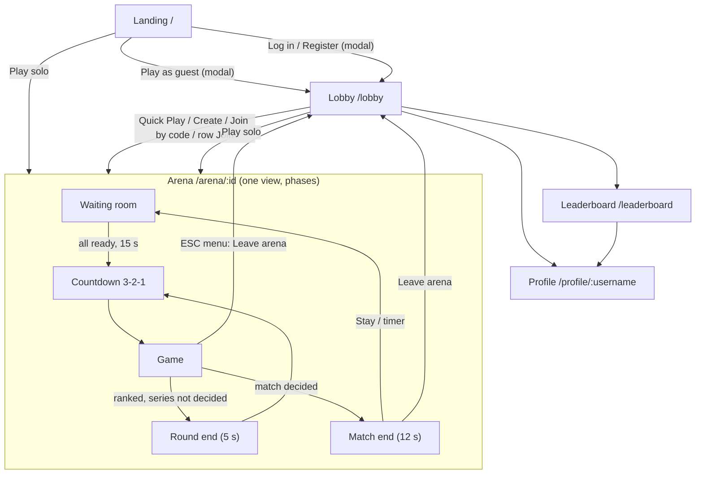

# BomberMan Online: Design System

| | |
|---|---|
| **Version** | 0.1 (draft) |
| **Date** | 2026-11-14 |
| **Parent** | [GUI-PLAN.md](./GUI-PLAN.md) (screens, architecture) - Sprints: [agile_steps.md](./agile_steps.md) |
| **Sources** | [mockups/](./mockups/index.html): `mockups.css` (retro), `mockups-modern.css` (modern), `theme.js`, `arena.js`, `touch.js`, `mock.js` and the eight screen files |

**Changes in 0.1:** first draft. Routes, design tokens for both mockup themes, the component inventory, a Tailwind v4 mapping proposal and the open design questions.

This document is the bridge between the static HTML mockups in `docs/mockups/` and the Vue 3 + TypeScript + Tailwind app that will live in `web/`. It lists every screen and its route, extracts the design tokens from the mockup CSS and canvas code, names the reusable components, and proposes how the tokens become Tailwind classes. The mockups and GUI-PLAN stay the source of truth for what a screen shows; this doc says how it is built and styled. Everything about `web/` here is a proposal: nothing under `web/` exists yet.

**A few terms used below:**

- **Design token:** a named design value, such as a color, a font size or a corner radius. Components use the name (`--color-surface`), never the raw value (`#111726`). Changing the value in one place changes it everywhere.
- **CSS custom property** (also "CSS variable"): how a token lives in the browser, for example `--color-surface: #111726;`. It is read with `var(--color-surface)`. It can be changed at runtime, which is what makes theme switching work.
- **Theme:** a set of values for the same tokens. The mockups have two: **retro** (v1) and **modern** (v2).
- **Tailwind utility:** a small CSS class that does one thing, such as `bg-surface` (background = surface color) or `rounded-panel`.
- **Route / view:** a route is a URL pattern (`/lobby`); the view is the Vue component that fills the page for that route (`LobbyView`).
- **Prop / variant:** a prop is an input to a component (`<BaseButton variant="primary">`); a variant is one of its predefined looks.

---

## 1. Site map and routes

### 1.1 Routes and screens

Pages have a route. Modals and in-arena phases have no route of their own: they open on top of a page, so the player never loses context (GUI-PLAN 3). The arena phases (waiting room, countdown, game, round end, match end) all live inside one view, `ArenaView`, at `/arena/:id`.

| Screen | Kind | Path | Route name | View / component | Mockup | First sprint |
|---|---|---|---|---|---|---|
| Landing | page | `/` | `landing` | `LandingView` | `landing.html` | **1** |
| Play as guest | modal (Landing) | - | - | `GuestNicknameForm` in `BaseModal` | `landing.html#guest` | 11 |
| Log in | modal (Landing) | - | - | `LoginForm` in `BaseModal` | `landing.html#login` | 15 |
| Register | modal (Landing) | - | - | `RegisterForm` in `BaseModal` | `landing.html#register`, `#register-mismatch`, `#register-error` | 15 |
| Solo difficulty | modal (Landing, Lobby) | - | - | `SoloDifficultyDialog` | none (GUI-PLAN 4.2 says solo is not mocked) | 10 (the sprint 8 button starts without a choice) |
| Lobby | page | `/lobby` | `lobby` | `LobbyView` | `lobby.html` | 11 |
| Quick Play search | modal (Lobby) | - | - | `QuickPlayDialog` | `lobby.html#quickplay`, `#quickplay-guest` | 13 (guest, unrated), 16 (ranked) |
| Create arena | modal (Lobby) | - | - | `CreateArenaDialog` | `lobby.html#create`, `#create-private`, `#create-guest` | 11 (private toggle 13, ranked 16) |
| Join by code | modal (Lobby) | - | - | `JoinByCodeDialog` | `lobby.html#join`, `#join-error` | 13 |
| Register to play Ranked | modal (Lobby) | - | - | `RankedLockedDialog` | `lobby.html#ranked-locked` | 16 |
| Settings | modal (any screen) | - | - | `SettingsDialog` | `lobby.html#settings` | 19 |
| Arena | page | `/arena/:id` (`?code=XXXXXX` joins a private arena) | `arena` | `ArenaView` | `waiting-room.html`, `game.html`, `results.html` | **1** (canvas only) |
| - Waiting room | phase `waiting`, `ready_countdown` | - | - | `WaitingRoom` | `waiting-room.html` (+ `#countdown`, `#paused`, `#not-host`) | 12 (private code 13, ranked duo 16) |
| - Countdown | phase `countdown` | - | - | `CountdownOverlay` | `game.html#countdown` | 4 |
| - Game + HUD | phase `playing` | - | - | `GameStage` | `game.html` | canvas **1**, kill feed 4, HUD 7 |
| - Hit / sudden death | states of the game | - | - | `GameStage` effects | `game.html#hit`, `#sudden` | 4 (HP), 7 (sudden death) |
| - Eaten by an alien | overlay | - | - | `DeathOverlay` | `game.html#eaten` | 8 |
| - Spectating | overlay | - | - | `SpectatorBanner` | `game.html#spectating` | 4 |
| - Round end (ranked) | phase `round_end` | - | - | `RoundEndOverlay` | `game.html#round-end` | 16 |
| - Match end / results | phase `match_end` | - | - | `MatchEndOverlay` | `results.html` (+ `#pending`, `#draw`, `#unrated`) | 4 (simple), 12 (full), 17 (rating column); solo result 8 |
| - ESC menu | modal (in game) | - | - | `EscMenu` | `game.html#esc` | not named in the sprint plan |
| - New version | modal | - | - | `VersionDialog` | `game.html#version` | 13 (GUI-PLAN 9) |
| - Reconnecting | overlay | - | - | `ReconnectOverlay` | none | 13 |
| - Touch layout | mode, not a route | - | - | `TouchControls` + compact HUD | `game.html#touch` | 9 |
| Profile | page | `/profile/:username` | `profile` | `ProfileView` | `profile.html` (+ `#placement`) | 18 |
| Leaderboard | page | `/leaderboard` | `leaderboard` | `LeaderboardView` | `leaderboard.html` | 18 |
| Privacy | page | `/privacy` | `privacy` | `PrivacyView` | none | 5 (Events 12.5) |
| Not found | page | `/:pathMatch(.*)` | `not-found` | `NotFoundView` | `not-found.html` | not named; cheap to add with the router in sprint 1 |

Guards stay as in GUI-PLAN 3: `/` redirects to `/lobby` when a session exists; `/lobby` and `/arena/:id` need a session (user or guest); profile, leaderboard, privacy and not-found are public.

**Sprint 1 needs only two things** (agile_steps sprint 1): the Landing page and the arena canvas with a Small / Medium / Large choice. Login, register and guest modals come later (sprints 11 and 15), even though GUI-PLAN 13 lists them in G1.

**Differences from GUI-PLAN 3 and the mockups** (GUI-PLAN wins where they disagree):

- `/privacy` is new. The sprint plan (sprint 5) and Events 12.5 need a privacy page linked from a footer, but GUI-PLAN 3 has no such route. Add it there.
- `mock.js` labels the profile route `/profile/:name` and the 404 route `*`. GUI-PLAN uses `/profile/:username` and `/:pathMatch(.*)`. Follow GUI-PLAN.
- `results.html` is a separate mockup page. In the app it is not a page: it is `MatchEndOverlay` inside `ArenaView` (GUI-PLAN 5.2), drawn over the frozen canvas.
- The ESC menu's Settings button links to `lobby.html#settings`, which would leave the game. In the app it opens `SettingsDialog` in place.
- Sprint 4 plans room links at `/a/<code>`. GUI-PLAN uses `/arena/:id?code=`. See open question Q7.

### 1.2 Navigation



- Solo arenas skip the waiting room and go straight to the countdown (GUI-PLAN 4.2, sprint 12).
- Settings opens as a modal from the top bar on any page and from the ESC menu in game.
- The top bar (brand, Lobby, Leaderboard, ping, settings, user chip) is on Lobby, Profile, Leaderboard and Not found. The Landing page has a lighter top bar (brand + Leaderboard). The arena uses its own room bar or HUD instead.

---

## 2. Design tokens

All values below are copied from the mockups. "retro" is `mockups.css`, "modern" is `mockups-modern.css` (it overrides retro under `[data-theme="modern"]`), and the canvas values come from `arena.js` (`PAL`, `COLORS`, `MOD`, `MOD_P`). Where the mockups use a raw value instead of a variable, the "In mockups" column says *literal*.

Every token gets a semantic name: it says what the value is **for** (`--color-surface`), not what it looks like (`--dark-navy`). Section 4 shows how these names become Tailwind classes.

### 2.1 Colors: UI

| Token | In mockups | Retro | Modern | Used for |
|---|---|---|---|---|
| `--color-bg` | `--bg` | `#0a0e18` | `#070a13` (+ 32 px grid and two radial glows on `body`) | Page background |
| `--color-surface` | `--surface` | `#111726` | `#0e1322` | Panels, cards, modal card (retro) |
| `--color-surface-2` | `--surface-2` | `#161d30` | `#131a2c` | Default button background |
| `--color-surface-3` | `--surface-3` | `#1c2439` | `#1b2339` | Hover, checked segment, toast, icon tiles |
| `--color-field` | `--field` | `#0d1220` | `rgba(255,255,255,0.035)` | Inputs, selects, segmented controls, code boxes |
| `--color-glass` | `--glass` (modern only) | = surface (`#111726`) | `rgba(12,16,28,0.62)` | Panels and cards in modern (with blur) |
| `--color-glass-strong` | literal | `rgba(17,23,38,0.94)` | `rgba(12,16,28,0.84)` | Modal card, banners, results card (alpha varies 0.78-0.95) |
| `--color-bar` | literal | `rgba(10,14,24,0.86)` | `rgba(8,11,20,0.62)` | Sticky top bar |
| `--color-hud-bar` | literal | `rgba(10,14,24,0.92)` | `rgba(8,11,20,0.8)` | HUD top bar, kill feed, touch top bar |
| `--color-stage` | literal | `#070a12` | `#060912` | Area behind the arena canvas |
| `--color-scrim` | literal | `rgba(5,7,12,0.72)` | `rgba(4,6,12,0.6)` (overlay: `0.66`) | Modal backdrop, dimmed overlays |
| `--color-track` | literal | `#2b3247` | `rgba(255,255,255,0.12)` | Empty heart, toggle off, empty slot dot, guest avatar |
| `--color-edge` | `--edge` / `--glass-edge` | `rgba(255,255,255,0.08)` | `rgba(255,255,255,0.09)` | Default 1 px borders and dividers |
| `--color-edge-strong` | `--edge-strong` | `rgba(255,255,255,0.14)` | `rgba(255,255,255,0.15)` | Input and button borders, hover borders |
| `--color-ink` | `--ink` | `#f3f1ea` | `#f3f1ea` | Main text |
| `--color-muted` | `--muted` | `#a7adbd` | `#a7adbd` | Secondary text, labels |
| `--color-dim` | `--dim` | `#6f768b` | `#858da3` | Hints, table headers, captions |
| `--color-on-accent` | literal | `#1d1305` | `#1d1305` | Text on fire-gradient buttons |
| `--color-on-player` | literal | `#0a0e18` | `#0a0e18` | Letter on a player-colored avatar, "YOU" tag |
| `--color-fire-1` | `--fire-1` | `#ffdd55` | `#ffdd55` | Accent yellow, focus outline, warnings |
| `--color-fire-2` | `--fire-2` | `#ff8a1f` | `#ff8a1f` | Accent orange, focus border, active tab, own row |
| `--color-fire-3` | `--fire-3` | `#ff3d2e` | `#ff3d2e` | End of the fire gradient |
| `--color-ok` | `--ok` | `#47d16c` | `#3ddc84` | Ready, waiting, live dot, rating up |
| `--color-bad` | `--bad` | `#ff4d5a` | `#ff5468` | Errors, hearts, rating down, sudden death |
| `--color-info` | `--info` | `#4da3ff` | `#5aa9ff` | Info alert |
| `--color-warn` | none (uses `--fire-1`) | `#ffdd55` | `#ffdd55` | Warning alert, high-ping icon (proposed alias) |
| `--color-p1` | `--p1` | `#4da3ff` | `#2f9be6` | Player 1 |
| `--color-p2` | `--p2` | `#ff9a3c` | `#f5b034` | Player 2 |
| `--color-p3` | `--p3` | `#47d16c` | `#19c29a` | Player 3 |
| `--color-p4` | `--p4` | `#e46bd6` | `#e79bcb` | Player 4 |
| `--color-tier-bronze` | `--t-bronze` | `#cd8a50` | `#e09a5f` | Tier badge |
| `--color-tier-silver` | `--t-silver` | `#b9c3d3` | `#c3cddd` | Tier badge |
| `--color-tier-gold` | `--t-gold` | `#f2c14e` | `#f5c84f` | Tier badge |
| `--color-tier-platinum` | `--t-platinum` | `#67d4cf` | `#6fe0da` | Tier badge |
| `--color-tier-diamond` | `--t-diamond` | `#8fb8ff` | `#9cc2ff` | Tier badge |
| `--color-alien-drifter` | `--a-drifter` | `#5fd35a` | `#4ade80` | HUD alien legend |
| `--color-alien-seeker` | `--a-seeker` | `#9b5de5` | `#a78bfa` | HUD alien legend |
| `--color-alien-brute` | `--a-brute` | `#c0392b` | `#fb4f6b` | HUD alien legend |

**Gradients** (not colors, but tokens all the same):

| Token | Retro | Modern |
|---|---|---|
| `--gradient-fire` | Buttons: `linear-gradient(180deg, fire-1, fire-2)`. Hero title, countdown and 404: three stops `fire-1 0%, fire-2 55%, fire-3 100%` | Always three stops (`--fire-grad`) |
| `--gradient-fire-hover` | `linear-gradient(180deg, #ffe57a, #ff9a3c)` | `linear-gradient(180deg, #ffe68a, #ff9a3c 55%, #ff5a3c)` |
| `--gradient-glass-hi` | none | `linear-gradient(180deg, rgba(255,255,255,0.045), transparent 42%)` (top sheen on glass) |

**Inconsistencies found in the UI colors:**

- In retro, player colors reuse status colors: `--p1` = `--info` (`#4da3ff`) and `--p3` = `--ok` (`#47d16c`). A "ready" chip and player 3 look the same. Modern keeps them apart.
- Retro buttons use a two-stop fire gradient, while retro titles use three stops. Modern always uses three.
- Modern has both `--edge` (`0.08`) and `--glass-edge` (`0.09`) and uses them almost interchangeably. One token is enough.

### 2.2 Colors: arena canvas

The canvas cannot read Tailwind classes, so these colors live in a TypeScript palette (section 4.4), not in CSS. Today `arena.js` hard-codes them twice: once for the retro painter (`PAL`, `COLORS`, inline literals) and once for the modern painter (`MOD`, `MOD_P`). A dash means the theme does not use that part.

| Token (palette key) | Retro | Modern | What it is |
|---|---|---|---|
| `floor` | `#171e30` | `#0a0f1c` | Floor tile |
| `floorAlt` | `#1a2236` | - | Checkerboard second floor color |
| `grid` | - | `rgba(130,160,255,0.07)` | Tile grid lines |
| `gridNode` | - | `rgba(150,180,255,0.18)` | Dots at grid crossings |
| `hard` | `#39446a` | gradient `#26314f` -> `#151c31` | Hard wall (pillar) |
| `hardRim` | = `hard` | gradient `#1b2339` -> `#0f1526` | Hard wall on the border |
| `hardHighlight` | `#5a6a96` | `rgba(255,255,255,0.10)` | Top light edge |
| `hardSide` | `#46537d` | - | Left bevel |
| `hardShade` | `#232a42` | - | Bottom bevel, rivets |
| `hardEdge` | - | `rgba(150,175,255,0.22)` | Outline stroke |
| `hardChip` | - | `rgba(120,160,255,0.12)` | Center plate |
| `soft` | `#8a5a3a` | `#261a15` + gradient `rgba(255,170,70,0.34)` -> `rgba(255,61,46,0.10)` | Soft wall (bricks / energy crate) |
| `softHighlight` | `#b07a50` | - | Brick top |
| `softShade` | `#5a3824` | - | Brick bottom |
| `softMortar` | `#432a1b` | - | Mortar between bricks |
| `softEdge` | - | `rgba(255,165,90,0.55)` | Crate outline |
| `softLine` | - | `rgba(255,190,120,0.25)` | Crate inner lines |
| `outline` | `#0a0d17` | - | Dark outline around sprites |
| `shadow` | `rgba(0,0,0,0.35)` | `rgba(0,0,0,0.45)` | Drop shadow under actors |
| `visor` | `#0d1322` | `#0a0f1c` | Player visor |
| `eye` | `#e9fbff` | `#e6f7ff` (glow `#9fdcff`) | Player eyes |
| `nameTag` | `rgba(10,13,23,0.75)` | `rgba(8,12,22,0.8)` | Name label background |
| `players` | `#4da3ff #ff9a3c #47d16c #e46bd6` | `#2f9be6 #f5b034 #19c29a #e79bcb` | Same as `--color-p1..p4` |
| `bombBody` | `#252c42` | gradient `#46527a` -> `#0b0f1c` | Bomb |
| `bombBodyFast` | `#3a2430` | (same body) | Bomb in the last 0.5 s |
| `bombRing` | - | `#ff8a1f` (fast: `#ff3d5a`) | Glowing ring and glow |
| `fuse` | `#c9a46a` | `#c9a46a` | Fuse cord |
| `spark` | `#ffdd55` / `#ff8a1f` (flicker) | `#fff3c4` (glow `#ffdd55`) | Fuse spark |
| `fireOuter` | `#ff3d2e` | `rgba(255,90,40,0.8)` | Outer flame |
| `fireMid` | `#ff8a1f` | `#ffb347` | Middle flame |
| `fireInner` | `#ffdd55` | - | Inner flame |
| `fireCore` | `#fff6d0` | `#fff6d0` | Hot core |
| `burningWall` | `rgba(255,138,31,0.55)` | `rgba(255,120,40,0.35)` | Soft wall being destroyed |
| `itemHealth` | `#ff4d5a` | `#ff5468` | Heart collectible (= `--color-bad`) |
| `itemFire` | `#ff8a1f` | `#ff8a1f` | Flame collectible |
| `itemBomb` | `#ffdd55` | `#ffdd55` | Bomb collectible |
| `itemBg` | `#121827` | `#0d1324` | Collectible badge background |
| `danger` | `rgba(255,40,50,0.16)` | `rgba(255,59,92,0.16)` | Danger-preview tint |
| `halo` | fill `rgba(255,60,70,0.10-0.18)`, stroke `rgba(255,80,90,0.30-0.55)` | fill `rgba(255,59,92,...)`, stroke `rgba(255,80,110,0.35-0.65)` | Pulsing danger halo under aliens |
| `falling` | stroke `rgba(255,61,46,0.8)` | stroke `rgba(255,61,46,0.85)` + glow `#ff3d2e` | Sudden-death falling block |
| `lock` | `#ff3b3b` | `#ff3b5c` | Red Seeker eye (only if hunting is chosen, SPEC 4.7.1) |
| `drifter` | `#5fd35a` | `#4ade80` (highlight `#86efac`) | Drifter body (= `--color-alien-drifter`) |
| `drifterDark` | - | `#15803d` | Drifter gradient end |
| `seeker` | `#9b5de5` | `#a78bfa` (highlight `#ddd6fe`) | Seeker body |
| `seekerDark` | `#5a2f8a` | `#5b21b6` | Tentacles / gradient end |
| `brute` | `#c0392b` | `#fb4f6b` | Brute body |
| `bruteDark` | `#8e2a20` | `#9f1239` | Brute lower body / gradient end |
| `bruteEye` | `rgba(255,210,80,0.7-1)` | `rgba(255,210,80,0.7-1)` | Glowing eye slit |
| `armorPip` | `#ff5a5a` | `#ff6b7d` | Brute armor pips (HP) |

Other canvas differences between the themes:

- Retro draws pixel art with `imageSmoothingEnabled = false` and `image-rendering: pixelated`. Modern draws vector shapes with smoothing on and `shadowBlur` glows, and uses `globalCompositeOperation = 'lighter'` for fire.
- Modern gives each player a **crest** shape so color is never the only cue: P1 circle, P2 triangle, P3 square, P4 diamond. Retro players all have the same shape.

### 2.3 Typography

**Fonts.** Every mockup page loads `https://fonts.googleapis.com/css2?family=Bungee&family=Inter:wght@400;500;600;700;800&display=swap`.

| Token | In mockups | Retro | Modern | Used for |
|---|---|---|---|---|
| `--font-display` | `--font-display` | `"Bungee", "Arial Black", "Segoe UI Black", Impact, system-ui, sans-serif` | `Inter, system-ui, -apple-system, "Segoe UI", Roboto, "Helvetica Neue", Arial, sans-serif` | Titles, clock, countdown, big numbers |
| `--font-ui` | `--font-ui` | `Inter, system-ui, -apple-system, "Segoe UI", Roboto, "Helvetica Neue", Arial, sans-serif` | same | Body text, tables, buttons |
| `--font-mono` | `--font-mono` (modern only) | - | `ui-monospace, "Cascadia Mono", "SF Mono", Menlo, Consolas, monospace` | Invite codes |
| `--font-code` | none (proposed) | today `--font-display` (Bungee) | `--font-mono` | Invite code boxes, code pill, invite panel. See Q3. |
| `--font-weight-display` | literal | `400` (Bungee has one weight) | `800` | Display text |

**Sizes.** Body text is `15px/1.5`. The mockups use about 20 different pixel sizes; this scale groups them.

| Token | Retro | Modern | Used for |
|---|---|---|---|
| `--text-2xs` | 11px (10px for tags) | 10.5px | Badges, table headers, stat labels, uppercase labels |
| `--text-xs` | 12px | 12px | Hints, captions, small meta |
| `--text-sm` | 13px | 13px | Chips, alerts, filters, small buttons, HUD stats |
| `--text-md` | 14px | 14px | Buttons, nav links, tables |
| `--text-base` | 15px | 15px | Body |
| `--text-lg` | 16px (17px room title, brand) | 15-17px | Panel titles, large buttons, slot names |
| `--text-xl` | 18px | 19px | Modal title |
| `--text-2xl` | 22px | 22px | HUD clock, banner headline |
| `--text-page` | `clamp(24px, 4vw, 32px)` | `clamp(26px, 4vw, 36px)` | Page title |
| `--text-hero` | `clamp(44px, 10vw, 84px)` | `clamp(42px, 9vw, 76px)` | Landing title |
| `--text-countdown` | `clamp(96px, 18vw, 180px)` | same | 3-2-1-GO numbers |
| `--text-404` | `clamp(90px, 22vw, 180px)` | same | 404 number |

Other display sizes appear once each (ring number 26px, rating 34/36px, invite code `clamp(30px, 6vw, 42px)`, code box 24/26px) and can stay local to their component.

**Letter spacing.**

| Token | Retro | Modern | Used for |
|---|---|---|---|
| `--tracking-display` | `0.02em` | `-0.02em` | Display text |
| `--tracking-hero` | normal | `-0.035em` | Landing title |
| `--tracking-label` | `0.06em`-`0.08em` | `0.14em`-`0.18em` | Uppercase labels, table headers |
| `--tracking-code` | `0.12em`-`0.18em` | `0.22em` | Invite codes |

Numbers that change in place (clock, ping, scores, ratings) use `font-variant-numeric: tabular-nums` (class `.num` in the mockups), so digits don't jump.

**Inconsistencies:** the modern 404 number uses `font-weight: 900`, but Inter is loaded only up to 800, so the browser fakes it or falls back to 800. Modern pages also download Bungee although they never use it.

### 2.4 Spacing and component sizes

The mockups use a loose 2 px grid: gaps and paddings of 2, 3, 4, 5, 6, 7, 8, 9, 10, 12, 14, 16, 18, 20, 22, 24, 26 and 28 px. Most of them fall on a 4 px step, and the rest are halves (10, 14, 18, 22). **Proposal:** keep Tailwind's default spacing step of 4 px (`--spacing: 0.25rem`), so `p-4` = 16 px and `gap-2.5` = 10 px. Snap the odd values (3, 5, 7, 9 px) to the nearest step when porting.

Fixed component sizes are the same in both themes and become size tokens:

| Token | Value | Where |
|---|---|---|
| `--size-control-sm` | 32px | Small button height |
| `--size-control` | 42px | Button, input and select height |
| `--size-control-lg` | 52px | Large button height |
| `--size-icon-btn` | 38px | Icon button (30px inline in the code pill, 34px in the touch bar) |
| `--size-topbar` | 62px | Page top bar |
| `--size-hud-top` | 58px (54px under 900px) | In-game top bar |
| `--size-hud-side` | 250px | In-game side columns |
| `--size-killfeed` | 46px | Kill feed bar |
| `--size-touch-bar` | 48px | Touch layout top bar |
| `--size-page` | 1180px | Max content width |
| `--size-modal` | 460px | Default modal width (380-420px for small dialogs) |
| `--size-modal-wide` | 680px | Settings modal |
| `--size-results` | 900px | Match end card |
| `--size-avatar` | 32px / 64px / 80px / 84px | Top bar / slot / ranked slot / profile |
| `--size-ring` | 76px | Ready countdown ring |
| `--size-code-box` | 48 x 58px (40 x 50px under 640px) | Join-by-code boxes |
| `--size-joystick` | 96px base, 44px knob, 38px travel | Touch joystick (GUI-PLAN 7.1, size "M") |
| `--size-bomb-btn` | 72px | Touch bomb button |

### 2.5 Radii

| Token | Retro | Modern | Used for |
|---|---|---|---|
| `--radius-control-sm` | 8px | 10px | Small buttons |
| `--radius-control` | 10px | 12px | Buttons, inputs, selects, icon buttons, alerts (modern alerts 14px) |
| `--radius-control-lg` | 12px | 14px | Large buttons |
| `--radius-badge` | 6px | 999px (pill) | Badges, tier-up tag |
| `--radius-kbd` | 7px | 8px | Key caps |
| `--radius-card` | 12px | 16px | HUD player cards, aliens box, round boxes (modern round box 14px) |
| `--radius-panel` | 14px (`--radius`) | 20px | Panels |
| `--radius-tile` | 16px | 20px | Lobby action cards, player slots, podium, banners |
| `--radius-modal` | 18px | 22px | Modal card |
| `--radius-sheet` | 20px | 24px | Match end card |
| `--radius-avatar` | 9px (16px in slots, 20px large) | 50% | Avatars |
| `--radius-pill` | 999px | 999px | Chips, toggles, live dot; in modern also nav links, toasts, segmented controls |

**Inconsistency:** modern declares `--radius: 18px`, but no modern component uses 18px. Panels override it to 20px, and GUI-PLAN 6.3 says "18-24 px". Use the per-component tokens above instead of one `--radius`.

### 2.6 Shadows, glows and blur

| Token | Retro | Modern | Used for |
|---|---|---|---|
| `--shadow-focus` | `0 0 0 3px rgba(255,138,31,0.18)` | `0 0 0 3px rgba(255,138,31,0.16), 0 0 24px -6px rgba(255,138,31,0.6)` | Focused input, current code box |
| `--shadow-focus-error` | `0 0 0 3px rgba(255,77,90,0.15)` | `0 0 0 3px rgba(255,84,104,0.15), 0 0 22px -8px rgba(255,84,104,0.7)` | Invalid input |
| `--shadow-accent` | `0 8px 24px rgba(255,138,31,0.25)` | `--fire-glow`: `0 10px 32px -10px rgba(255,120,30,0.7)` (+ inset highlight) | Primary button, bomb button |
| `--shadow-lift` | none | `0 24px 60px -24px rgba(0,0,0,0.7)` | Glass panels and cards |
| `--shadow-inset-hi` | none | `inset 0 1px 0 rgba(255,255,255,0.05)` (0.06-0.07 on modals) | Top highlight on glass |
| `--shadow-modal` | `0 30px 90px rgba(0,0,0,0.55)` | `0 30px 90px rgba(0,0,0,0.6)` + inset + `0 0 0 1px rgba(0,0,0,0.3)` | Modal card |
| `--shadow-overlay` | `0 30px 80px rgba(0,0,0,0.5)` | `0 30px 80px rgba(0,0,0,0.55)` | Banners (results card: `0 40px 100px rgba(0,0,0,0.6)`) |
| `--shadow-toast` | `0 16px 40px rgba(0,0,0,0.45)` | glass + blur | Toast |
| `--glow-player` | `0 0 30px color-mix(in srgb, var(--pc) 15%, transparent)` | `0 0 40px -10px color-mix(in srgb, var(--pc) 55%, transparent)` | Own slot / own HUD card (`--pc` = that player's color) |
| `--glow-dot` | `0 0 8px <color>` | `0 0 0 3px <color 18%>, 0 0 10px <color>` | Ping and live dots |
| `--blur-glass` | none | `blur(14px) saturate(125%)` | Glass panels, bars, toasts |
| `--blur-scrim` | `blur(4px)` | `blur(8px)` (in-stage overlay `3px`) | Modal backdrop |

**Focus ring** (both themes): `outline: 2px solid var(--color-fire-1); outline-offset: 2px` on `:focus-visible`. The touch bomb button uses `3px solid var(--color-ink)` with a 4px offset. GUI-PLAN 11 asks for visible focus rings on every menu.

### 2.7 Z-index layers

The values are the same in both themes. Tailwind v4 has no z-index theme namespace, so these stay plain CSS variables (used as `z-(--z-modal)`).

| Token | Value | What sits there |
|---|---|---|
| `--z-raised` | 1-2 | Landing content above its arena background, results card above its backdrop |
| `--z-stage-flash` | 3 | Hit flash (red screen edge) inside the stage |
| `--z-stage-hint` | 4 | Sudden-death hint inside the stage |
| `--z-stage-overlay` | 5 | Countdown, death, spectating and round-end overlays inside the stage |
| `--z-topbar` | 20 | Sticky top bar |
| `--z-modal` | 60 | Modals and their backdrop |
| `--z-toast` | 70 | Toasts (above modals) |
| `--z-debug` | 100 | Dev-only overlays (debug RTT, latency simulator). In the mockups: the theme switch and mockup navigator. |

The mockups' touch preview uses 80 for its full-screen phone frame. The app has no phone frame, so it needs no token.

### 2.8 Motion

| Token | Retro | Modern | Used for |
|---|---|---|---|
| `--duration-press` | 80ms | 120ms | Button press / lift transform |
| `--duration-hover` | 150ms | 200ms | Color, border and shadow transitions |
| `--duration-fade` | 180ms | 180ms | Modal backdrop fade-in |
| `--duration-modal` | 220ms | 320ms | Modal card entrance |
| `--duration-shake` | 400ms | 400ms | Wrong code, hearts shake on hit |
| `--duration-pop` | 600ms | 600ms | Rating delta, tier-up badge |
| `--ease-out` | `ease-out` | `ease-out` | Fades, one-shot effects |
| `--ease-pop` | `cubic-bezier(0.2, 0.9, 0.3, 1.2)` (slight overshoot) | `cubic-bezier(0.2, 0.8, 0.2, 1)` (no overshoot, plus a 4px blur-in) | Modal entrance |

Looping animations (keyframes) in the mockups: `blink` 1s / 1.6s (rebinding key, sudden-death clock, live dot), `slotPulse` 1.2s (newcomer slot), `hitFlash` 1.2s, `shimmer` 1.2s (rating "updating..."), `dot` 1.4s (waiting dots), `spin` 1.6s (Quick Play radar), `rowIn` 1.6s (new lobby row), `throb` 1.2s and `flicker` 0.18s (landing bomb), `sdPulse` 1s (sudden-death border); modern adds `mPulse` 1.8s, `mGlow` 2-3s and `mRise` 0.32s. Countdown numbers (1 s each), the round-end bar (5 s) and the match-end bar (12 s) are game timing, not design tokens: they must follow the server, not CSS.

**Reduced motion in the mockups:**

- `mockups.css` has one global rule under `@media (prefers-reduced-motion: reduce)`: every animation and transition is cut to 0.001 ms and runs once, and the countdown shows its first number ("3") as a still.
- Modern's own animations only run under `prefers-reduced-motion: no-preference`, and its hover lifts (`translateY`) are turned off under `reduce`.
- `arena.js` draws one still frame instead of a loop; the touch demo still redraws on every game tick.
- GUI-PLAN 4.8 and 11 also want an **in-app "Reduced motion" setting** (no flashes or shake, shorter animations). The mockups only follow the operating system setting. See section 4.3 for a proposal that handles both.

### 2.9 Breakpoints

The mockups are written **desktop first** with `max-width` media queries. Tailwind is **mobile first** (`min-width`): the class without a prefix is the phone layout, and `md:` and up add the wider layouts. The port flips the direction but keeps the same widths.

| Token | Value | What changes at this width in the mockups |
|---|---|---|
| `--breakpoint-sm` | 30rem (480px) | Phone: the touch layout fills the screen instead of a phone frame |
| `--breakpoint-md` | 40rem (640px) | Top bar hides labels, slot grid 2 columns, invite panel stacks, smaller code boxes |
| `--breakpoint-lg` | 56.25rem (900px) | In-game: side columns become horizontal rows above and below the canvas |
| `--breakpoint-xl` | 62.5rem (1000px) | Lobby action cards, waiting room, podium, round details and match history go to one column |
| `--breakpoint-2xl` | 73.75rem (1180px) | Page content reaches `--size-page` |

Touch controls are not a breakpoint: they turn on with `matchMedia('(pointer: coarse)')` or the Settings choice (GUI-PLAN 7.1).

### 2.10 Token count

| Group | Retro | Modern |
|---|---|---|
| UI colors (2.1) | 38 | 38 |
| Gradients (2.1) | 2 | 3 |
| Canvas palette (2.2) | 41 | 41 |
| Typography (2.3: families, weight, sizes, tracking) | 20 | 21 |
| Component sizes (2.4, shared) | 18 | 18 |
| Radii (2.5) | 12 | 12 |
| Shadows, glows, blur (2.6) | 9 | 12 |
| Z-index (2.7, shared) | 8 | 8 |
| Motion (2.8) | 8 | 8 |
| Breakpoints (2.9, shared) | 5 | 5 |
| **Total** | **161** | **166** |

A theme counts a token when it gives it its own value (a dash or "none" in the tables does not count). Retro has no `--font-mono`, no glass sheen gradient, and no lift, inset-highlight or glass-blur shadows. Both canvas palettes leave out 8 of the 49 keys.

---

## 3. Component inventory

Names follow GUI-PLAN 5.1 where it already names the component; new names are marked *(new)*. "Sprint" is the first sprint that needs the component (from section 1.1 and agile_steps). **Bold 1** = needed in sprint 1.

### 3.1 Common building blocks (`components/common/`)

| Component | Props / variants | Used on | Tokens | Sprint |
|---|---|---|---|---|
| `AppIcon` *(new)* | `name` (one of the ~40 icons in `mock.js`: bomb, fire, heart, trophy, gear, lock, star, crown, alien, skull, play, ...), `size` | Every screen | `currentColor` | **1** |
| `BaseButton` | `variant`: `default`, `primary`, `danger`, `ghost`, `ok`; `size`: `sm`, `md`, `lg`; `block`; `disabled`; optional leading icon; renders `<a>`/`RouterLink` or `<button>` | Every screen | surface-2/3, edge-strong, gradient-fire, on-accent, bad, ok, radius-control*, size-control*, shadow-accent, focus ring | **1** |
| `IconButton` *(new)* | `icon`, `label` (for `aria-label`), `size` | Top bar settings, modal close, kick player, copy code, in-game menu | edge, muted, ink, radius-control, size-icon-btn | 4 |
| `BrandLogo` *(new)* | `compact` (hide text under 640px) | All top bars, Landing | font-display, fire-2 / gradient-fire | **1** |
| `KeyCap` | `label`, `rebinding` (blinking orange) | Landing hints, waiting room controls, ESC menu, settings | field, edge-strong, radius-kbd, font-ui | **1** |
| `SegmentedControl` *(new)* | `options`, `modelValue`, `disabled` per option | Sprint 1 size picker, create arena (mode, players, size), settings, profile filter | field, edge, surface-3, radius-control / pill | **1** |
| `BaseModal` | `title`, `size`: `sm` (380-420px), `md` (460px), `wide` (680px); slots: default, `footer`; `closable` | All dialogs | glass-strong / surface, edge-strong, scrim, blur-scrim, radius-modal, shadow-modal, z-modal, duration-modal | 8 |
| `Panel` *(new)* | `title`, slots: `head-extra`, default; `padded` | Lobby, waiting room, profile, leaderboard | surface / glass, edge, radius-panel, shadow-lift, blur-glass | 11 |
| `BaseInput` *(new)* | `invalid`, `hint`, `hintTone` (`ok`, `err`), leading icon | Auth forms, create arena, lobby search | field, edge-strong, fire-2 focus, bad, radius-control, shadow-focus(-error) | 11 |
| `BaseSelect` *(new)* | same as `BaseInput` | Lobby filters, create arena region, settings region | same | 11 |
| `BaseCheckbox` *(new)* | label | Lobby "Hide full", "Keep me logged in" | fire-2 (`accent-color`) | 11 |
| `ToggleSwitch` *(new)* | `modelValue`, label, sub-label | Create arena "Private", settings | track, fire-2 / gradient-fire, radius-pill | 13 |
| `BaseSlider` | `min`, `max`, `unit`, `prefix`, `locked` | Create arena rules, audio volumes | fire-2 | 11 |
| `Badge` *(new)* | `tone`: `ranked`, `unrated`, `guest`, `host`, `live`, `private`; icon | Lobby rows, waiting room, results, profile history | fire-1, fire-2, muted, dim, ok, radius-badge, text-2xs, tracking-label | 11 |
| `Chip` *(new)* | `hot` (ranked) | Waiting room rules, results head, landing hints (modern) | edge, muted, fire-1, radius-pill | 12 |
| `AlertBox` *(new)* | `tone`: `info`, `warn`, `err` | Auth modals, join error, ESC menu | info, warn, bad, radius-control | 11 |
| `DividerLabel` *(new)* | text | Create arena, settings | dim, edge, tracking-label | 11 |
| `TabList` *(new)* | `tabs`, `modelValue` | Settings | muted, ink, fire-2 underline | 19 |
| `Avatar` *(new)* | `letter`, `playerIndex` (sets `--pc`), `size`: `sm`, `md`, `lg`, `xl`; `guest`; `empty` | Top bar user chip, slots, me bar, profile | p1-p4, on-player, track, radius-avatar, size-avatar | 11 |
| `PlayerSwatch` *(new)* | `playerIndex` | HUD cards, results table | p1-p4 (modern: round + glow) | 4 |
| `HeartsMeter` *(new)* | `hp`, `max` (5) | HUD cards, touch bar | bad, track | 4 |
| `RoundPips` *(new)* | `wins`, `needed` (2), `playerIndex` | HUD ranked, round end, touch bar | p1-p4 | 16 |
| `SlotDots` *(new)* | `filled`, `max` | Lobby players column | ink, track | 11 |
| `ProgressRing` *(new)* | `percent`, `state`: `run`, `grey`; `size`: `md`, `sm`; slot for number or icon | Ready countdown, "Register to play Ranked" | fire-2, track, field, size-ring | 12 |
| `DrainBar` *(new)* | `durationMs` | Round end (5 s), match end (12 s) | gradient-fire, track | 4 |
| `Shimmer` *(new)* | width | Rating "updating..." | track | 17 |
| `Toast` | `tone`, text | Errors, server draining (GUI-PLAN 9) | surface-3 / glass-strong, edge-strong, shadow-toast, z-toast | 13 |
| `Spinner` | `kind`: `dots`, `radar` | Waiting slot, Quick Play search | muted, fire-2 | 11 |
| `PingBadge` | `ms`, `region`, `compact` | Top bars, HUD | ok / warn / bad by threshold, glow-dot | 13 (sprint 5 has a debug RTT readout first) |
| `AppTopBar` *(new)* | `variant`: `full`, `landing`; current nav item | Lobby, profile, leaderboard, not found, landing | bar, edge, blur, size-topbar, z-topbar | **1** (landing variant) |
| `UserChip` *(new)* | user or guest | Top bar | edge, avatar, tier | 11 |
| `AppFooter` *(new)* | build number, privacy link, "Report a bug" | All pages except the arena | dim, xs | 5 |
| `ThemeToggle` *(new)* | `modelValue`: `retro` / `modern` | Settings Display tab (and Landing until Settings exists) | as `SegmentedControl` | **1** only if both themes stay (Q1) |
| `Pager` *(new)* | `page`, `pages` | Profile history, leaderboard | edge, muted, `BaseButton sm` | 18 |

### 3.2 Landing and auth (`views/`, `components/auth/`)

| Component | Props / variants | Used on | Tokens | Sprint |
|---|---|---|---|---|
| `ArenaBackdrop` *(new)* | `scene` (static map, actors), `cover`, `still`, `blur` | Landing background, waiting room map preview, results backdrop, 404 strip | stage, canvas palette, scrim gradients | **1** (Landing) |
| `LiveCounter` *(new)* | players online, arenas running | Landing | ok (dot), muted | 11 |
| `GuestNicknameForm` | - | Landing modal | inputs, alert | 11 |
| `LoginForm` | - | Landing modal | inputs, checkbox | 15 |
| `RegisterForm` | states: mismatch, server errors | Landing modal | inputs, hint ok/err | 15 |

### 3.3 Lobby (`components/lobby/`)

| Component | Props / variants | Used on | Tokens | Sprint |
|---|---|---|---|---|
| `LobbyActionCard` *(new; GUI-PLAN has `QuickPlayButton`)* | `primary`, icon, title, subtitle | Quick Play, Create arena, Join by code, Play solo | surface / glass, gradient-fire icon tile, radius-tile | 11 |
| `ArenaTable` / `ArenaRow` | row states: `new` (flash in), `faded` (high ping), `locked` (guest on ranked), `full`, `in game` | Lobby | table tokens, badge, slot dots, tier | 11 |
| `CreateArenaDialog` | user / guest; ranked locks the rules | Lobby | modal, segmented, slider, toggle | 11 |
| `JoinByCodeDialog` + `CodeInput` *(new)* | `length` (6), `error` | Lobby | font-code, size-code-box, field, shadow-focus, duration-shake | 13 |
| `QuickPlayDialog` *(new)* | user (ranked) / guest (unrated) | Lobby | radar spinner, display font | 13 |
| `RankedLockedDialog` *(new)* | - | Lobby (guest) | ring, alert | 16 |
| `RegionPicker` | - | Create arena, settings | select | 13 |
| `MeBar` *(new)* | user stats / guest hint | Lobby bottom | panel, tier, avatar | 11 |

### 3.4 Arena: waiting room, game and results (`components/arena/`)

| Component | Props / variants | Used on | Tokens | Sprint |
|---|---|---|---|---|
| `GameCanvas` | mounts `GameClient` (`markRaw`), `theme` | Arena | stage, canvas palette | **1** |
| `GameStage` | phase; holds the overlays below | Arena | stage, z-stage-* | **1** (canvas only) |
| `WaitingRoom` | `mode`: unrated, private, ranked; `isHost` | Arena | panel, rules chips, ready box | 12 |
| `PlayerSlotCard` | `player` or empty; `me`, `newcomer` (pulse), `duo` (ranked size), `kickable`, ready state | Waiting room | glass, p1-p4 top bar, glow-player, avatar, ok | 12 |
| `InviteCodePanel` *(new)* + `CodePill` *(new)* | `code`, copy actions | Waiting room (private), room bar | font-code, tracking-code, gradient-fire / fire-1 | 13 |
| `RulesChips` *(new)* | ruleset | Waiting room | chip | 12 |
| `MapPreview` *(new)* | size; blurred until countdown | Waiting room | `ArenaBackdrop`, radius-card | 12 |
| `ReadyCountdown` | `state`: waiting, running, paused (+ reason), you-wait | Waiting room | ring, display font | 12 |
| `ReadyToggle` *(new)* | pressed = ready (green), not pressed = orange call to action | Waiting room | gradient-fire, ok | 12 |
| `HudTopBar` *(new)* | holds `HudTimer`, round title, `SuddenDeathChip`, `PingBadge`, menu button | Game | hud-bar, size-hud-top | 7 |
| `HudTimer` | `seconds`, `danger` (red blink from 2:00) | Game, touch bar | font-display, text-2xl, bad | 7 |
| `SuddenDeathChip` *(new)* | `inSeconds` / `now` | Game | fire-1, bad | 7 |
| `HudPlayerCard` | `me`, `out` (grey), `empty`, `leader` (crown), pips | Game side columns | surface / glass, p1-p4 side stripe, glow-player, hearts | 7 |
| `HudAliensBox` *(new)* | counts per type | Game | alien colors | 8 |
| `KillFeed` | events (newest at full strength) | Game | hud-bar, muted, p1-p4 names | 4 |
| `RoundScoreBar` | round n / N, pips | Game (ranked) | font-display | 16 |
| `CountdownOverlay` | `title` (ROUND 2 / GET READY / DECIDING ROUND) | Game | scrim, text-countdown, gradient-fire | 4 |
| `HitFlash` *(new)* | `active` | Game | bad glow, z-stage-flash; off under reduced motion | 4 |
| `DeathOverlay` *(new)* | `cause`, alien portrait | Game | bad, scrim, canvas portrait | 8 |
| `SpectatorBanner` | players left | Game | glass-strong, `BaseButton danger` | 4 |
| `RoundEndOverlay` | winner, series score, points | Game (ranked) | glass-strong, shadow-overlay, drain bar | 16 |
| `MatchEndOverlay` | `mode`: ranked, unrated, solo; `ratingPending`; draw | Game | sheet radius, table, rating delta, tier-up, drain bar | 4 |
| `EscMenu` | - | Game | modal sm | not named in the sprint plan |
| `VersionDialog` *(new)* | - | Any (protocol mismatch) | modal sm | 13 |
| `ReconnectOverlay` | grace countdown | Game | scrim, spinner | 13 |
| `TouchControls` (+ `TouchJoystick`, `BombButton` *(new)*) | `size` S/M/L, `leftHanded`; bomb count, empty state | Game on touch devices | gradient-fire, size-joystick, size-bomb-btn | 9 |
| `TouchTopBar` *(new)* | compact timer, both players, menu | Game on touch devices | hud-bar, size-touch-bar | 9 |

### 3.5 Profile, ranking, settings

| Component | Props / variants | Used on | Tokens | Sprint |
|---|---|---|---|---|
| `TierBadge` | `tier`, optional rating | Top bar, lobby, slots, profile, leaderboard | tier colors (diamond marker with glow) | 11 (rating shown from 17) |
| `RankedBadge` | - | Lobby, results, profile | `Badge ranked` | 16 |
| `RatingDelta` | `delta`, `pending` | Results, profile history | ok, bad, shimmer, duration-pop | 17 |
| `TierUpBadge` *(new)* | up / down | Results | gradient gold, radius-badge | 17 |
| `ProfileHeader` *(new)* + `StatsSummary` | rated / placement | Profile | avatar xl, font-display, stat grid | 18 |
| `RatingHistoryChart` | points, tier bands | Profile | fire-2 line, tier colors, dim axis text | 18 |
| `MatchHistoryTable` | rows expand to round boxes | Profile | table, badge, round box | 18 |
| `LeaderboardTable` + `Podium` *(new)* | own row pinned | Leaderboard | table `me` row, fire-1 / tier silver / tier bronze ranks | 18 |
| `SettingsDialog` + `SettingRow` *(new)* + `KeyBindingRow` | tabs: Controls (incl. Touch), Audio, Display, Network, Dev | Any | modal wide, tabs, toggles, segmented | 19 |

**Sprint 1 component list:** `AppIcon`, `BaseButton`, `BrandLogo`, `KeyCap`, `SegmentedControl` (Small / Medium / Large), `AppTopBar` (landing variant), `ArenaBackdrop` (Landing background), `GameStage` + `GameCanvas`, and `ThemeToggle` only if Q1 keeps both themes.

---

## 4. Tailwind mapping proposal

### 4.1 Tailwind v4 with `@theme`, not a `tailwind.config.js`

**Proposal: use Tailwind CSS v4** (the current major version), installed with its Vite plugin `@tailwindcss/vite`.

Why v4:

- **Tokens are CSS variables by design.** In v4 the theme is written in CSS inside an `@theme` block. Every token there (`--color-surface`) becomes both a utility class (`bg-surface`) and a real CSS variable. The class reads the variable at runtime, so overriding the variable under `[data-theme="modern"]` switches the theme **without a rebuild**. In v3 the same needs a `tailwind.config.js` that points each color at `var(...)` by hand.
- **No JavaScript config file.** One CSS file holds every token, which is easy to compare with the mockup CSS.
- **Browser support fits.** v4 needs Safari 16.4+, Chrome 111+ and Firefox 128+. The mockups already rely on `:has()` and `color-mix()`, which need about the same browsers.

### 4.2 Token file

Retro is the default here because it is the mockups' default; Q1 may change that. The values are the tokens from section 2.

```css
/* web/src/styles/tokens.css (proposal, shortened) */
@import "tailwindcss";

@theme static {
  /* Start from an empty palette and breakpoint list: only our tokens exist. */
  --color-*: initial;
  --breakpoint-*: initial;

  /* Retro values (default) */
  --color-bg: #0a0e18;
  --color-surface: #111726;
  --color-surface-2: #161d30;
  --color-edge: rgb(255 255 255 / 0.08);
  --color-ink: #f3f1ea;
  --color-muted: #a7adbd;
  --color-fire-1: #ffdd55;
  --color-fire-2: #ff8a1f;
  --color-p1: #4da3ff;
  /* ... the rest of section 2.1 ... */

  --font-display: "Bungee", "Arial Black", Impact, system-ui, sans-serif;
  --font-ui: Inter, system-ui, -apple-system, "Segoe UI", Roboto, sans-serif;

  --text-page: clamp(24px, 4vw, 32px);
  --radius-control: 10px;
  --radius-panel: 14px;
  --shadow-modal: 0 30px 90px rgb(0 0 0 / 0.55);
  --ease-pop: cubic-bezier(0.2, 0.9, 0.3, 1.2);

  --breakpoint-sm: 30rem;
  --breakpoint-md: 40rem;
  --breakpoint-lg: 56.25rem;
  --breakpoint-xl: 62.5rem;
  --breakpoint-2xl: 73.75rem;
}

/* Not Tailwind theme namespaces: plain variables. */
:root {
  --z-topbar: 20;
  --z-modal: 60;
  --z-toast: 70;
  --size-control: 42px;
  --blur-glass: none;
}

/* Modern overrides the same variable names. Utilities pick it up at once. */
:root[data-theme="modern"] {
  --color-bg: #070a13;
  --color-surface: #0e1322;
  --color-surface-2: #131a2c;
  --color-edge: rgb(255 255 255 / 0.09);
  --color-p1: #2f9be6;
  /* ... */
  --font-display: Inter, system-ui, sans-serif;
  --text-page: clamp(26px, 4vw, 36px);
  --radius-control: 12px;
  --radius-panel: 20px;
  --blur-glass: blur(14px) saturate(125%);
}

/* For the few places where the themes differ in more than a value. */
@custom-variant modern (&:where([data-theme="modern"], [data-theme="modern"] *));
@custom-variant retro (&:where([data-theme="retro"], [data-theme="retro"] *));
```

- `@theme static` makes Tailwind write out every variable, even ones no class uses yet. The canvas palette check (4.4) and hand-written CSS can then rely on them.
- Namespaces decide the class names: `--color-*` gives `bg-*`, `text-*`, `border-*`; `--font-*` gives `font-*`; `--text-*` gives text sizes; `--radius-*` gives `rounded-*`; `--shadow-*` gives `shadow-*`; `--ease-*` gives `ease-*`; `--breakpoint-*` gives `sm:` ... `2xl:`.
- Tokens outside a namespace (z-index, sizes, blur) are used with the variable shorthand, such as `z-(--z-modal)` and `h-(--size-control)`, or in plain CSS (`backdrop-filter: var(--blur-glass)`).

A component then only names tokens:

```vue
<!-- components/common/BaseButton.vue (template excerpt, proposal) -->
<button
  class="inline-flex items-center gap-2 h-(--size-control) px-4.5 rounded-control
         border border-edge-strong bg-surface-2 text-ink font-semibold text-md
         transition-colors duration-150 hover:bg-surface-3
         focus-visible:outline-2 focus-visible:outline-offset-2 focus-visible:outline-fire-1
         modern:backdrop-blur-md"
>
  <slot />
</button>
```

Variants (`primary`, `danger`, `ghost`, sizes) are a small TypeScript map from the variant name to a class string, tested with Vue Test Utils like any other component (test-first, CLAUDE.md).

### 4.3 Theme switching, reduced motion and fonts

- **First paint.** A tiny inline script in `web/index.html` sets `data-theme` on `<html>` before the CSS loads, like the mockups' `theme.js`, so the page never flashes the wrong theme. It reads `localStorage` inside `try/catch` and falls back to the default when storage is blocked.

  ```html
  <script>
    var t = null
    try { t = localStorage.getItem('bm-theme') } catch (e) {}
    document.documentElement.dataset.theme = t === 'modern' ? 'modern' : 'retro'
  </script>
  ```

- **Changing it.** The `settings` Pinia store (GUI-PLAN 5.3, already persisted to `localStorage`) gets a `theme` field. Changing it writes `data-theme` on `<html>`, saves the choice and tells `GameClient` to swap its canvas palette and redraw the static layer. Unlike the mockups, the app needs no `?theme=` URL fallback: when storage is blocked, the theme just resets to the default on reload.
- **Reduced motion.** Two sources, one result: the operating system (`prefers-reduced-motion: reduce`) or the in-app setting, which sets `data-motion="reduce"` on `<html>`. One base rule handles both:

  ```css
  @media (prefers-reduced-motion: reduce) {
    :root { --motion-scale: 0; }
  }
  :root[data-motion="reduce"] { --motion-scale: 0; }
  ```

  CSS animations multiply their duration by `--motion-scale`, and `GameClient` checks the same two sources to skip screen flashes and shake (GUI-PLAN 11). Tailwind's `motion-safe:` / `motion-reduce:` variants only see the operating system setting, so they are not enough on their own.
- **Fonts.** Proposal: self-host Inter and (if retro stays) Bungee as `woff2` files in `web/src/assets/fonts/` (the folder already exists in GUI-PLAN 5.1) instead of loading Google Fonts. The browser then contacts no third party, which keeps the privacy page shorter (Events 12.5), and it works the same through the sprint 2-4 tunnel. Load only the weights in use (400-800).

### 4.4 Canvas palette

```ts
// web/src/game/renderer/palette.ts (proposal)
export type ThemeName = 'retro' | 'modern'

export interface ArenaPalette {
  floor: string
  floorAlt: string | null      // null: this theme has no checkerboard
  players: readonly [string, string, string, string]
  // ... one field per key in section 2.2
}

export const PALETTES: Record<ThemeName, ArenaPalette> = {
  retro: { floor: '#171e30', floorAlt: '#1a2236', players: ['#4da3ff', '#ff9a3c', '#47d16c', '#e46bd6'] /* ... */ },
  modern: { floor: '#0a0f1c', floorAlt: null, players: ['#2f9be6', '#f5b034', '#19c29a', '#e79bcb'] /* ... */ },
}
```

- The renderer reads one palette object; it never reads CSS at 60 FPS.
- A Vitest test reads `tokens.css` and checks that `players`, the alien colors and the item colors in each palette equal the matching CSS tokens. The HUD and the canvas then can't drift apart, which today's duplicated values in `arena.js` and the CSS allow.
- If only one theme survives Q1, `PALETTES` keeps one entry and `ThemeName` one member.

### 4.5 Planned files under `web/src/`

Consistent with GUI-PLAN 5.1. *(new)* marks additions to that tree.

```
web/
  index.html                  inline theme boot script (4.3)
  src/
    main.ts                   imports styles/main.css
    styles/                   (new folder)
      main.css                @import "./tokens.css"; base and reduced-motion rules
      tokens.css              @theme tokens + [data-theme="modern"] overrides (4.2)
    assets/fonts/             self-hosted Inter (+ Bungee) woff2
    stores/settings.ts        + theme, reducedMotion
    game/renderer/
      palette.ts              (new file) canvas palettes (4.4)
    components/
      common/                 BaseButton, BaseModal, BaseSlider, Toast, Spinner, KeyCap, PingBadge (GUI-PLAN)
                              + AppIcon, IconButton, BrandLogo, SegmentedControl, Panel, BaseInput, BaseSelect,
                                BaseCheckbox, ToggleSwitch, Badge, Chip, AlertBox, DividerLabel, TabList, Avatar,
                                PlayerSwatch, HeartsMeter, RoundPips, SlotDots, ProgressRing, DrainBar, Shimmer,
                                AppTopBar, UserChip, AppFooter, ThemeToggle, Pager, ArenaBackdrop (new)
      auth/ lobby/ arena/ profile/ ranking/ settings/   as in GUI-PLAN 5.1, plus the (new) names in section 3
    views/                    + PrivacyView (new)
```

Nothing here is created yet. The `web/` scaffold is a sprint 1 task, built test-first.

---

## 5. Inconsistencies between the mockups and GUI-PLAN

| # | Where | What differs | Suggested resolution |
|---|---|---|---|
| 1 | GUI-PLAN 6.3, first table | Says background `#12141c`, panels `#1d2130`, accent `#ffcc33`, title font "Press Start 2P". Neither mockup theme uses these. The "Two designs" table further down in the same section matches the mockups. | Update the first table to the section 2 tokens. |
| 2 | Player colors | GUI-PLAN 6.3: Okabe-Ito `#0072B2 #E69F00 #009E73 #CC79A7`. Modern: brightened Okabe-Ito. Retro: old palette `#4da3ff #ff9a3c #47d16c #e46bd6`, and P1/P3 equal the info/ok colors. | Q2. |
| 3 | Shape cue | GUI-PLAN 6.3 and 11: a unique helmet shape per player. Modern has crests; retro players all share one shape, and HUD swatches are color only. | Give retro the crests too, and put the crest shape in `PlayerSwatch`. |
| 4 | Invite code font | Retro sets codes in Bungee (Q looks like O). Modern uses a monospace font. | Q3. |
| 5 | Fonts loaded | Modern 404 uses weight 900, but only 400-800 is loaded. Modern pages load Bungee without using it. | Use 800; load Bungee only for retro. |
| 6 | Contrast | Retro `--dim` (`#6f768b`) on `--bg` is about 4.3:1 by hand calculation, under the WCAG AA 4.5:1 for small text, and hints use it at 12px. Modern `--dim` (`#858da3`) is about 6:1. GUI-PLAN 11 asks for AA. | Raise retro `--dim`; measure all pairs with a tool (Q8). |
| 7 | Radius | Modern declares `--radius: 18px` but uses 20/22/24px; GUI-PLAN says 18-24px. | Per-component radius tokens (2.5). |
| 8 | Ping colors | GUI-PLAN 9: green / yellow / red. Mockups have only green and yellow (`.ping.warn`). | `PingBadge` uses ok / warn / bad. |
| 9 | Reduced motion | GUI-PLAN 4.8 and 11 have an in-app setting; the mockups only follow the OS. | 4.3. |
| 10 | Canvas scaling | GUI-PLAN 6.1 wants integer scaling with smoothing off and a 16 x 16 pixel sprite atlas (6.4, sprint 19). The modern arena is vector art with smoothing on. | Q6. |
| 11 | Results | `results.html` is its own page; GUI-PLAN 5.2 makes it `MatchEndOverlay` inside `ArenaView`. | Follow GUI-PLAN. |
| 12 | Routes | `mock.js`: `/profile/:name`, `*`. Sprint 4: `/a/<code>`. Sprint 5: a privacy page that GUI-PLAN 3 lacks. | Section 1.1; Q7. |
| 13 | Solo | GUI-PLAN 4.1 and 4.2 add Play Solo on Landing and Lobby, a difficulty choice, an empty-lobby hint and a solo result; no mockup shows them (GUI-PLAN says so). The Landing mockup also pairs Log in / Register side by side instead of four stacked buttons. | Design solo screens before sprint 8 (agile_steps sprint 19 plans the mockup refresh). |
| 14 | Settings content | The mockup's Display tab has a "Danger preview" toggle that GUI-PLAN 4.8's table lacks (6.2 mentions it), and no theme choice. | Add both to GUI-PLAN 4.8 if Q1 keeps two themes. |
| 15 | Sprint 1 scope | GUI-PLAN 13 (G1) includes the auth and guest modals; the sprint plan builds them in sprints 11 and 15. | Follow the sprint plan. |
| 16 | Duplicated colors | Player, alien and item colors exist both in the CSS and hard-coded in `arena.js`. | One palette, checked by a test (4.4). |

---

## 6. Open questions

| # | Question | Notes |
|---|---|---|
| Q1 | **One theme or two?** Does the Vue app keep both retro and modern with a switch, or pick one? | Two themes cost a second canvas painter, a second set of token values and twice the visual checks. If both stay: where does the switch live (Settings > Display, plus Landing?), which is the default, and does it need `ThemeToggle` in sprint 1? |
| Q2 | **Retro player colors.** Retro still uses the old palette, while GUI-PLAN 6.3 says Okabe-Ito. Switch retro to Okabe-Ito too? | Also fixes P1 = info and P3 = ok in retro. And what does the "Colorblind palette" setting (GUI-PLAN 4.8, 11) switch to, when the default is already colorblind-safe? A separate high-contrast set would be a third set of player tokens. |
| Q3 | **Invite codes that read clearly.** In retro's Bungee, Q looks like O. | Options, not exclusive: set codes in a plainer font (`--font-code` = monospace in both themes), and have the server never generate look-alike characters (O/0, I/1, Q). The second is a SPEC change. |
| Q4 | **Waiting-room slots.** The mockup always shows 4 slots, whatever max players was chosen. | Show exactly max-players slots (2, 3 or 4)? Ranked already shows 2. |
| Q5 | **Not verified yet:** phone-size layout of every screen (only the in-game touch view was designed for phones), reduced-motion behavior, blocked-storage fallbacks, and measured contrast. | Plan a check before sprint 9 (phones) and sprint 20 (accessibility). |
| Q6 | **Art direction vs. the sprite plan.** If modern wins, the arena is vector art; GUI-PLAN 6.1 / 6.4 and sprint 19 plan a 16 x 16 pixel sprite atlas with integer scaling. | Decide before sprint 19, ideally before the renderer port in sprint 1. |
| Q7 | **Arena routes before invite codes.** Sprint 1-3 has one fixed arena, sprint 4 plans `/a/<code>`, GUI-PLAN has `/arena/:id?code=`. | Proposal: use `/arena/:id` from sprint 1 (for example `/arena/local`), and make sprint 4's room links `/arena/<code>` instead of `/a/<code>`. |
| Q8 | **Contrast pass.** Retro `--dim` is below AA by hand calculation; translucent modern surfaces change contrast with whatever is behind them. | Measure with a tool, fix in the tokens, and add a check to the Playwright visual tests. |
| Q9 | **Fonts.** Self-host Inter (and Bungee) or keep Google Fonts? | 4.3 proposes self-hosting. |
| Q10 | **Privacy route and footer.** Sprint 5 needs `/privacy` and a footer with the build number and "Report a bug", but GUI-PLAN 3 and the mockups have neither. | Add to GUI-PLAN 3 and design the footer. |
| Q11 | **Tailwind v4 browser floor** (Safari 16.4+, Chrome 111+, Firefox 128+). Acceptable for testers' phones? | The mockups already need about the same versions. |
